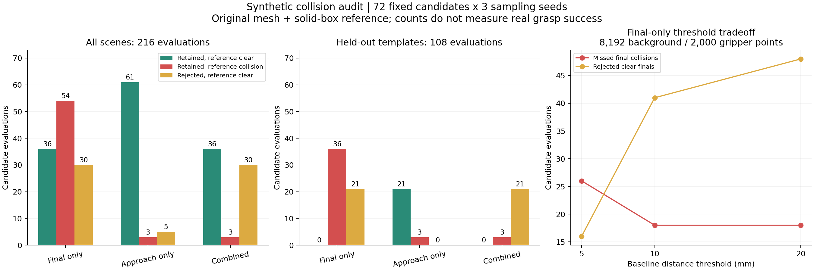

# 准备实验1、2：接近避碰与碰撞筛选可靠性

完成日期：2026-10-05。实现、实验及复核均已完成。原始输出：`runs/collision_experiments/prehardware_20261005/`。这是合成几何准备实验和官方场景集成验证，不是真实抓取成功率实验。

后续实验3、4已新增默认观测门控，见 [VISIBILITY_FUSION_RESULTS.md](VISIBILITY_FUSION_RESULTS.md)。本报告保留原始结果；复现本轮范围时使用 `--no-observation`。

## 主要结果

- 新增并默认启用固定朝向、100mm直线接近检查。能够检出终点无碰撞但途中被阻挡，以及目标自身与夹爪外壳的干涉。
- 0.5mm薄挡板用例：仅查起终点（100mm步长）漏检；20/5/1mm离散步长及连续检查均检出。新算法不依赖时间步长。
- 12个合成场景、72个固定候选、3个采样种子中，原筛选加上新检查后，整段参考下漏放从54降至3；相对于零余量参考的误拒绝仍为30。
- 剩余3次漏放是同一个被实体完全包围的候选在3个种子下的重复结果。其表面点没有进入夹爪扫掠体，点云方法漏检，独立实体参考能检出。增大点数或余量未解决该用例。
- **预留场景组中，组合筛选拒绝了全部21次参考可行候选，只保留3次上述漏检。不能仅以全组漏放减少宣称默认组合已经可靠。**原20mm终点阈值明显限制几何可行方案的覆盖率。
- 官方蓝碗完整链路：100个候选、53个评分/姿态合格，保留从7个变为5个；新增排除68、83。此样例没有完整独立参考，不将这2个新判定当作实物碰撞真值。

## 实验1：实现与独立参考

实现：`offline_core/approach.py`。

1. 官方 `config/grippers/robotiq_2f_140.yaml` 明确 `approach_direction=[0,0,1]`，资产坐标偏移为单位矩阵；`grasp_gen/robot.py` 也明确规范方向为+Z。因此 `t_pre = t_final - R_final @ [0,0,0.10]`。模型原点是GraspGen资产基座坐标，名义尖端深度195mm，不是已标定机器人TCP。
2. 官方封闭网格拆成11个连通部件，分别取凸包，保留两指之间空隙。其中10个原本为凸体，1个非凸基座被保守凸化。没有对整个夹爪取一个填满开口的凸包。
3. 场景点变换到终点夹爪坐标，通过凸体半空间求连续运动相交区间。没有夹爪表面采样或时间采样；包围盒来自偏移后凸体，计算按点分块。
4. 默认余量2mm按各凸面平移定义，是保守包络，不等于原始网格的精确欧氏距离。100mm和2mm均为准备实验预设，未经过实物校准。
5. 使用完整已观测背景和原始目标点云，不使用旧碰撞模块的背景抽样，也不使用去噪后的模型目标点云。检查全部评分/姿态合格候选，保留重叠原因。
6. 目标允许位于打开夹爪的几何空隙内，但不能穿入实体/余量包络；途中和终点都不整体移除目标。保持打开姿态，不模拟闭指或指垫挤压接触。
7. 导出预抓取4×4姿态、首次相交进度、相交来源及终点/途中原因；缺失目标或背景时返回未知并拒绝。

独立参考：`experiments/reference_geometry.py`。使用**原始三角网格与完整实体盒障碍物**，不使用被测点云、不将夹爪凸化。对移动三角形与轴对齐盒的13个分离轴求连续相交区间，另用每个封闭连通网格的立体角绕数检查初始包含关系。零余量，接触即碰撞。已通过100个随机盒运动用例与解析扫掠包围盒答案核对，也覆盖小盒在夹爪内、夹爪在大盒内两种包含关系。

参考只用于固定朝向平移及实体盒实验，不是通用机械臂运动规划器。

## 实验2：冻结协议

入口：`collision_experiments.py`。运行前写入 `protocol.json`，几何和候选保存为 `scenes.json`，包含源码及网格SHA256。

| 项目 | 设置 |
|---|---|
| 场景 | 12个：无障碍、指部/掌部穿入、薄挡板、指旁3mm/12mm间距、侧方障碍、细杆、抬高桌面、包围实体、目标在路径/掌部 |
| 候选 | 每场景6个固定平移扰动，共72个；各方法共用，不通过重新生成候选改变对照 |
| 划分 | 按预设序号分6个开发模板和6个预留模板，未据预留结果调参；模板难度不均衡，不代表真实分布 |
| 种子 | 1000、1001、1002；同一候选的采样重复，不能当216个独立场景 |
| 背景点数 | 2048、8192、32768 |
| 夹爪表面点数 | 500、2000、4000 |
| 旧终点阈值 | 5、10、20mm |
| 评估次数 | 27组×72候选×3种子=5832次终点评估 |
| 新接近余量 | 0、2、5mm，共648次候选评估 |
| 观测点 | 盒子全表面按面积均匀采样；每种子65536背景点、4096目标点；较小预算取嵌套前缀 |
| 参考范围 | 终点评价只含背景；整段评价含背景和目标 |
| 计时 | 每场景/配置/种子一次预热后调用；排除造点及参考计算，GPU计时含传输和同步 |

全表面采样不是RGB-D成像模拟，没有遮挡或深度噪声。夹爪表面也使用嵌套抽样；预算相同代表相同算法/参数，具体随机点不保证等于历史独立采样。

漏放率=`参考碰撞但被保留 / 保留数量`；同时报告碰撞样本漏检率=`漏放 / 参考碰撞数量`、保留总数、参考可行保留数、误拒绝数。误拒绝是相对于**零余量**参考的额外拒绝，可能由主动安全余量导致，不全部等于实现错误。全部拒绝时漏放率为空，不写0%。

## 结果表

以下216次评估均为72候选×3种子。整段参考中150次碰撞、66次可行。

| 方法：终点＋100mm接近段 | 保留 | 漏放 | 保留中的漏放率 | 参考可行保留 | 误拒绝 |
|---|---:|---:|---:|---:|---:|
| 原终点筛选，8192/2000点、20mm | 90 | 54 | 60.0% | 36 | 30 |
| 新连续检查，完整观测点、2mm | 64 | 3 | 4.69% | 61 | 5 |
| 当前组合：原终点筛选＋新检查 | 39 | 3 | 7.69% | 36 | 30 |

新模块同时改变路径范围、目标处理、夹爪表示、观测点预算；这是整体方案比较，不能把效果全部归因于单独增加“路径”。薄挡板实验单独检验时间步长。

预留模板108次评估：87次碰撞、21次可行。原筛选保留36次、全部为漏放；新连续检查保留24次，其中21次可行、3次漏放；组合仅保留3次、全部为漏放，其余21次可行被旧筛选拒绝。这是默认组合的实质局限。

**终点筛选可靠性**，固定夹爪表面2000点，参考96次碰撞、120次可行：

| 背景点 | 阈值 | 保留 | 漏放 | 误拒绝 | 每场景6候选平均耗时 | CUDA峰值申请 |
|---:|---:|---:|---:|---:|---:|---:|
| 2048 | 5mm | 155 | 44 | 9 | 3.65ms | 102.2MiB |
| 8192 | 5mm | 130 | 26 | 16 | 13.28ms | 384.6MiB |
| 8192 | 10mm | 97 | 18 | 41 | 13.40ms | 384.6MiB |
| 8192 | 20mm（原参数） | 90 | 18 | 48 | 13.51ms | 384.6MiB |
| 32768 | 20mm | 90 | 18 | 48 | 47.39ms | 1509.3MiB |

完整27组及分组结果见 `baseline_summary.csv`。增加到32768背景点未消除实体包含漏检，耗时/显存明显增加。20mm相比10mm在本组未减少漏放，却多拒绝7次几何可行候选。暂不根据这些合成模板改写实物参数。

新连续检查在0/2/5mm余量下漏放分别3/3/3次，误拒绝0/5/22次。扩大余量没有解决表面观测表示导致的包含漏检。



## 官方场景与验证

输出：`runs/offline/approach_validation_20261005/`。

- 与 `stage1_repeat` 相比，分割掩码、目标模型点云、完整/抽样背景、夹爪表面抽样、100个姿态及评分逐元素完全相同，旧终点排除原因完全一致。
- 保留ID按评分为80、85、64、67、33；新增排除68、83，首次相交进度约0.738、0.833，来源为目标，包含途中及终点干涉原因。
- 新接近阶段6.769秒；计算阶段总计8.489秒；CUDA峰值申请1686.9MiB。CPU接近阶段检查53个候选与完整观测点。这是一次集成测量，不是吞吐量统计。
- 25项单元测试全部通过：新增薄障碍、任意世界旋转、预抓取方向、目标干涉、开口、余量、未知输入、记录合并、实体参考测试；原16项接口测试继续通过。
- 实际GPU旧碰撞几何检查通过。
- `verify_collision_experiments` 独立重算全部CSV统计，核对参考标签、唯一身份、混淆计数、分母、组合筛选和薄障碍结果，通过。
- `verify_approach_run` 核对官方新旧输出、预抓取变换及新增拒绝原因，通过。证据为实验目录 `verification.json` 和新官方运行 `approach_verification.json`。

## 复跑

在本项目目录PowerShell中运行：

```powershell
# 新流程；自动使用新时间戳输出目录
.venv\Scripts\python.exe analyze_scene.py --official-sample --no-observation
# 历史终点模式
.venv\Scripts\python.exe analyze_scene.py --official-sample --no-approach
# 完整参数实验
.venv\Scripts\python.exe collision_experiments.py
.venv\Scripts\python.exe -m unittest discover -s tests -p "test_*.py" -v
.venv\Scripts\python.exe -m tests.verify_collision_geometry
# 复核及重绘本次保存结果
.venv\Scripts\python.exe -m tests.verify_collision_experiments runs/collision_experiments/prehardware_20261005
.venv\Scripts\python.exe -m tests.verify_approach_run runs/offline/stage1_repeat runs/offline/approach_validation_20261005
.venv\Scripts\python.exe plot_collision_experiments.py runs/collision_experiments/prehardware_20261005
```

主程序和实验脚本都拒绝覆盖非空输出目录。源码、配置、报告可以版本管理；运行输出仍遵循原 `.gitignore`。

下一项有实验依据的工作是已观测空闲/占据/未知空间处理，避免把被实体包围但缺少近邻表面点的区域判为可通行；设备到手后再确定接近长度、余量及接触模型。本次未实现未知空间模块，也未评估闭指、机械臂可达性或实际稳定抓取。
