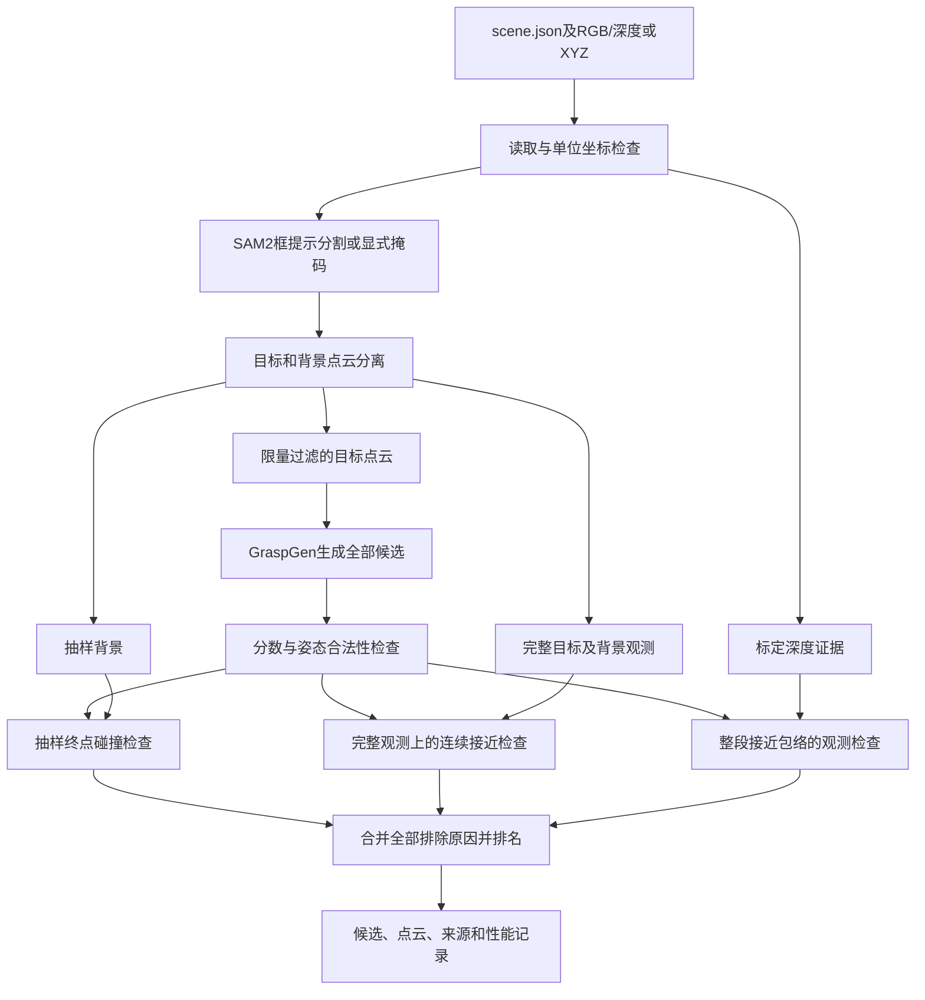

# 三维桌面抓取：系统架构、实验与实机开发

**2026-11-13 新桌面验证：** Gemini 2 新拍摄的 20 帧静态桌面已重建，马克杯、耳机盒、模型玩偶三件物体同场保留。马克杯与模型玩偶完成仿真抓放；耳机盒 64 个候选均未通过路径筛选。双击 [点选窗口](../../launchers/start_target_selection.cmd) 默认打开这次新照片。数据、尺寸估计、动画、失败原因与边界见 [新桌面布局验证](../current/NEW_DESK_20261113.md)。下文早期阶段文字保留为历史记录。

**点选目标已接入：** 双击 [点选窗口](../../launchers/start_target_selection.cmd)，在保存的 Gemini 2 照片上点水杯或纸盒，预览绿色分割区域，随后运行自动抓取。水杯点击结果已完成模型推理与仿真抓放；纸盒局部区域会提示补点。见 [点选目标说明与验证](../current/CLICK_TARGET.md)。

**场景与目标选择：** 统一入口已支持 `--scene` 指定场景配置、`--target` 选择物体，不再固定抓水杯。配置贯穿点云提取、推理、规划、动画与执行，每次独立保存结果并阻止旧场景候选混用。用法和当前支持的形状见 [场景与目标选择](../current/SCENE_SELECTION.md)。

**最新进展：** 已打通“Gemini 2 保存的实测水杯点云 → GraspGen 自动生成候选 → UR5 坐标转换与路径筛选 → 仿真抓放”。64 个候选中 9 个通过接近检查，按评分尝试 3 个后完成一次完整抓放，保留失败记录和原始点云外观动画。见 [自动抓取记录与一键入口](../simulation/GRASPGEN_MEASURED_CUP.md)。下方较早更新中“TCP 未对接”的描述已由本次帧对应验证补充。

**2026-11-12 更新：** 当前无实体机械臂，已完成 UR5＋2F-140 仿真抓放与整臂避障，并在本机跑通“虚拟 RGB-D → 目标点云 → GraspGen 候选”。两个虚拟场景各生成 16 个有效姿态，尚未完成模型夹爪与仿真 TCP 对接。运行入口和实测记录见 [GraspGen 恢复说明](../setup/GRASPGEN_RESTORED.md)、[虚拟相机](../camera/VIRTUAL_CAMERA.md)、[整臂规划](../simulation/MOTION_PLANNING.md)。下文 10 月内容保留为历史阶段说明。

**真实桌面场景接入：** Gemini 2 两视角融合后的纸盒与水杯几何已放入 UR5＋2F-140 仿真。水杯作为目标、纸盒作为障碍物，完整的仿真闭爪、抬升、搬运和放置已运行并录成 GIF。新版 GIF 显示原始实测点云外观，同时保留隐藏的简化碰撞体；这不等于实物抓取验证。见 [真实场景机械臂接入与动画](../simulation/RECONSTRUCTED_UR5.md) 和 [多视角重建](../camera/MULTIVIEW_CUP_BOX.md)。

文档更新：**2026-10-07**。项目目标是面向杂乱桌面的多视角三维抓取规划与避碰：选择目标、理解三维场景、生成夹爪姿态、解释排除原因，再逐步接入机械臂完成实际抓放。

**当前已实现离线分析和六项准备实验，尚未实现机械臂执行。** 实机方案固定使用 **Robotiq-2F-140**；机械臂品牌和型号尚未确定。RGB-D相机原计划为Gemini2，实际型号、SDK和安装方式需在设备到手时确认。第一版优先固定相机、静态场景和单物体抓放。

## 阅读导航

- [项目架构与数据流](#architecture)
- [文件架构与脚本职责](#files)
- [运行入口与环境](#run)
- [模块接口](#模块职责与接口)、[坐标约定](#坐标系和单位)、[输入格式](#自定义-rgb-d-输入)、[默认参数](#默认算法参数)、[输出文件](#输出文件)
- [现有实验与限制](#evidence)
- [设备到手后的开发与验收](#hardware-plan)
- [验证方法和资源恢复](#验证与环境)

## 当前实现概况

已将 **SAM2 分割 → 三维点云处理 → 官方 GraspGen 抓取生成 → 场景碰撞检查** 拆成模块。一个命令分析一个目标并保存全部候选，包含被排除的候选。

2026-10-05新增默认启用的**连续直线接近检查**，并完成碰撞采样可靠性对照。结果、局限与复跑步骤见 [COLLISION_EXPERIMENTS.md](COLLISION_EXPERIMENTS.md)。阶段1报告保留为历史终点筛选基线。

随后已完成**遮挡/未知空间处理及多视角融合预实验**，详见 [VISIBILITY_FUSION_RESULTS.md](VISIBILITY_FUSION_RESULTS.md)。默认新增深度观测门控：需带内外参的深度图，观测不足会拒绝并提示补拍。官方XYZ样例缺少该标定，若要复现此前几何筛选请加 `--no-observation`。

**准备实验5、6也已完成并核验**：159组噪声/缺点/掩码/真实SAM2框提示试验，以及48组融合点云压力测试，最大原始点数2,517,731。51次预处理中止和6次细障碍采样丢失均保留。50项单元测试通过。结果、显存/耗时表和失败示例见 [ROBUSTNESS_STRESS_RESULTS.md](ROBUSTNESS_STRESS_RESULTS.md)；正式入口尚未自动解决分割选错目标的问题。

<a id="architecture"></a>

## 项目架构与数据流

系统分成输入与标定、感知、抓取生成、几何与观测筛选、结果记录五个已实现部分。设备驱动、整臂规划和执行控制属于下一阶段。主流程由 `offline_core/pipeline.py` 调用各模块，而不是由模型直接给机器人发送运动命令。



评分及姿态合法的候选进入各项几何/观测检查；当前接近检查与观测检查不会只检查终点筛选已放行的候选，因此可以保留重叠的排除原因。最终保留状态综合所有已启用检查。

### 三条不同的数据用途

| 数据 | 用途 | 保留原则 |
|---|---|---|
| `target_model_m` | 抓取模型输入 | 限制点数并过滤，控制GPU内存和生成耗时 |
| `background_collision_m` | 抽样终点碰撞检查 | 用于现有快速检查，不能视为完整场景 |
| `target_raw_m`、`background_full_m`和标定深度 | 连续接近、未知空间判断与审查 | 保留完整有效观测；缺点不等于空闲空间 |

“完整观测”仍然只包含相机看到的部分，不包含物体背面真值。准备实验中已经出现细障碍被抽样删掉的情况，因此不能让推理和最终避碰共用同一份缩小后的点云作为全部依据。

### 单视角分析与多视角融合的关系

当前有三个明确分开的入口：

1. `analyze_scene.py`：对一个已保存场景生成并检查抓取候选。
2. `fuse_scene.py`：对同一静态目标的多个标定深度视角进行融合，可用受约束的点到平面配准修正初始位姿；进行重叠、几何退化和深度冲突等检查。
3. `recheck_fused_scene.py`：读取已有候选及通过质量检查的融合结果，保留候选身份和评分，再做几何及多视角观测复查。若来源相机位姿被修正，候选也应用对应修正。

融合入口目前要求各视角已经具有确认过的目标掩码，不会自动替多个视角完成目标识别。复查时还会校验候选来源视角、目标、坐标系、素材哈希和融合文件哈希。仅名称相同而输入不同的场景不能混用。

**融合点云重新生成一批抓取并完成与单视角的受控对照，尚未接入正式入口。** 现有融合复查验证了固定候选链路，不能把它描述成已完成完整多视角实机抓取。

### 结果语义与软件边界

- `accepted`：候选通过本次启用的检查，不代表机械臂可达或实物抓取成功。
- `insufficient_observation`：路径有未获得空闲证据的区域，需要补拍或重新规划。
- 融合的 `planning_allowed`：融合结果可以进入后续算法；不是允许机械臂立即执行的授权。
- 当前没有闭指接触仿真、整臂自碰撞/场景碰撞、关节限位检查、机器人命令发送或抓放成功验证。
- 新增实机层应消费明确坐标和版本的候选结果，执行前重新检查机器人状态、场景是否变化及完整运动路径。

<a id="files"></a>

## 文件架构与脚本职责

以下列出实际存在的主要文件。`.venv/`、`third_party/`和`checkpoints/`为本地运行资源，克隆仓库后需要单独恢复。

```text
graspgen_feasibility/
├── README.md                         # 本文：架构、接口、运行、实机方案
├── ARCHIVE.md                        # 归档范围和新机器恢复说明
├── DEVELOPMENT_PLAN.md               # 原始阶段计划及历史进展
├── RESULTS.md                        # 初始硬件可行性和推理基准
├── STAGE1_RESULTS.md                 # 离线核心与历史终点筛选基线
├── COLLISION_EXPERIMENTS.md           # 接近路径及碰撞可靠性报告
├── VISIBILITY_FUSION_RESULTS.md       # 遮挡、融合与固定候选复查报告
├── ROBUSTNESS_STRESS_RESULTS.md       # 输入退化及点云压力报告
├── analyze_scene.py                  # 单场景分析命令
├── fuse_scene.py                     # 多视角融合命令
├── recheck_fused_scene.py             # 融合结果复查命令
├── configs/
│   └── offline_default.json          # 模型路径、点数预算、检查参数
├── offline_core/
│   ├── config.py                     # 配置读取、合并和路径解析
│   ├── types.py                      # Scene / Segmentation / Clouds / Grasps
│   ├── scene_io.py                   # 场景契约、素材加载、输入来源
│   ├── geometry.py                   # 单位、坐标变换、姿态合法性
│   ├── official_sample.py            # 官方原始样例转换
│   ├── segmentation.py               # SAM2与显式掩码两种后端
│   ├── pointcloud.py                 # 目标/背景分离、抽样与过滤
│   ├── grasp.py                      # 官方GraspGen推理适配
│   ├── collision.py                  # 抽样终点检查与候选判定
│   ├── approach.py                   # 凸部件连续直线接近检查
│   ├── observation.py                # 深度证据与未知/空闲/占据/冲突
│   ├── fusion.py                     # 配准、融合、质量检查与来源保留
│   ├── pipeline.py                   # 主流程编排
│   ├── runtime.py                    # GPU初始化、种子、模型和源码来源
│   ├── profiling.py                  # 分阶段时间与显存记录
│   └── export.py                     # 排名、JSON/CSV/NPZ和叠加图输出
├── experiments/
│   ├── collision_suite.py            # 已知几何碰撞实验工具
│   ├── reference_geometry.py         # 独立参考几何，不作为推理输入
│   ├── synthetic_depth.py            # 合成深度、目标标签和相机视角
│   ├── input_degradation.py           # 噪声、缺点、掩码、框和体素处理
│   └── degradation_runner.py         # 退化实验执行、计时和失败保存
├── tests/
│   ├── test_offline_contract.py       # 输入输出契约和几何基础
│   ├── test_approach.py               # 连续接近检查
│   ├── test_observation_fusion.py     # 深度观测与融合检查
│   ├── test_fusion_recheck.py         # 融合来源与候选复查
│   ├── test_degradation_experiments.py # 输入退化和点云处理
│   └── verify_*.py                   # 已保存实验、碰撞函数及复现核验
├── data/
│   ├── offline_official/             # 已归档RGB、世界XYZ、有效掩码和scene.json
│   ├── model_files.json              # 官方下载资源索引
│   ├── download_manifest.json        # 已下载资源大小及SHA256
│   └── sample_data/                  # 官方原始数据，仅本地
├── runs/                             # 各阶段运行记录，见下表
├── requirements-local.txt            # 本机已验证依赖记录，非独立环境锁文件
├── download_assets.py                # 根据索引下载官方模型和样例
├── prepare_windows.py                # Windows环境适配辅助
├── build_pointnet.cmd                # 本机PointNet++扩展构建脚本
├── windows_compat.patch              # 第三方源码Windows兼容修改
├── .venv/                            # 本地Python环境，不上传
├── third_party/                      # 本地第三方代码，不上传
└── checkpoints/                      # 本地模型配置与权重，不上传
```

顶层实验及后处理脚本：

| 文件 | 职责 |
|---|---|
| `benchmark.py` / `pipeline_benchmark.py` | 初始抓取推理和分割集成基准 |
| `write_report.py` | 初始基准报告生成 |
| `collision_experiments.py` / `plot_collision_experiments.py` | 接近检查和采样碰撞对照、图表 |
| `visibility_fusion_experiments.py` / `plot_visibility_fusion.py` | 合成遮挡、不同视角及位姿误差实验、图表 |
| `robustness_experiments.py` | 深度噪声、缺点、掩码侵蚀/膨胀和真实SAM2框提示实验 |
| `pointcloud_stress_experiments.py` | 多分辨率融合输入、不同缩减方案、细障碍保留和性能压力 |
| `summarize_preparation_56.py` / `plot_preparation_56.py` | 从已保存结果汇总资源消耗并绘图，不重新生成实验结论 |

运行记录按用途组织：

| 目录或文件 | 保存内容 |
|---|---|
| `runs/`根目录的基准文件 | 初始推理候选、汇总、分割与集成结果 |
| `runs/offline/` | 单场景分析、历史基线及带观测检查的运行 |
| `runs/collision_experiments/` | 接近路径和碰撞对照 |
| `runs/visibility_fusion/` | 多版本合成实验；正式报告引用的版本为准 |
| `runs/fusion/` / `runs/recheck/` | 命令行融合产物及固定候选复查 |
| `runs/robustness/prehardware_20261005/` | 159组输入退化实验及图表 |
| `runs/pointcloud_stress/prehardware_20261005/` | 48组规模压力实验及图表 |
| `runs/preparation_56_verification.json` | 后两项共207组产物核验记录 |

失败输入和旧实验用于追溯，不应直接合并为同一统计样本。入口要求新输出目录；不要覆盖已封存结果。归档中的绝对路径保留运行时原貌，跨机器使用时应在新的输入副本中调整路径。

<a id="run"></a>

## 运行入口与环境

### 前提

命令示例假定已经恢复Python/CUDA环境、GraspGen代码和权重、SAM2代码和权重，并调整 `configs/offline_default.json` 的路径。当前SAM2路径复用本机旧项目目录，不是可在任意机器直接使用的路径。详见文末[验证与环境](#验证与环境)和[ARCHIVE.md](../setup/ARCHIVE.md)。

下面除注明外均从 `projects/graspgen_feasibility/` 运行。首先可以使用仓库已有的规范化官方输入：

```powershell
.venv\Scripts\python.exe analyze_scene.py --input data\offline_official\scene.json --no-observation
```

该命令不要求重新下载原始场景JSON，但模型和软件依赖仍需就绪。官方样例只有世界XYZ，没有用于认证空闲空间的标定深度，因此这里只复现几何分析。

### 已有本机环境的一条命令

在已有环境的本机 PowerShell 中，从任意目录运行：

```powershell
& "D:\3D_Vision\projects\graspgen_feasibility\.venv\Scripts\python.exe" "D:\3D_Vision\projects\graspgen_feasibility\analyze_scene.py" --official-sample --no-observation
```

控制台打印输出目录。默认输出到项目的 `runs/offline/时间戳/`。上述官方XYZ几何演示显式关闭缺少标定依据的观测门控；真实深度输入默认开启。首次运行把已下载的官方场景转换为规范输入，随后复用转换结果；不会自动联网下载。默认生成 100 个候选，评分阈值 0.8。

从项目目录运行的其他例子：

```powershell
.venv\Scripts\python.exe analyze_scene.py --official-sample --no-observation --candidates 200 --seed 1000
.venv\Scripts\python.exe analyze_scene.py --official-sample --no-approach
.venv\Scripts\python.exe analyze_scene.py --input D:\my_scene\scene.json --output runs\offline\my_scene
```

`--output` 必须指向不存在或空的目录，防止覆盖历史实验。失败时退出码为 2，并在输出目录保存 `failure.json`。参数解析或输出路径错误会直接报错。

`--official-sample` 会检查原始下载JSON及其哈希，即使已有转换结果，也要求原始文件存在。只持有仓库归档输入时，应使用上面的 `--input data\offline_official\scene.json`。`--no-approach` 示例用于历史终点基线，不代表推荐的实机检查配置。

### 多视角融合与复查

准备一个 `bundle.json`，其路径相对于该文件所在目录：

```json
{"views": ["view_0/scene.json", "view_1/scene.json", "view_2/scene.json"]}
```

各视角必须是同一静态目标、同一世界坐标、带内外参的深度输入，并在 `target.mask` 提供已确认掩码。先在其中一个原始视角生成候选，再融合并复查：

```powershell
.venv\Scripts\python.exe analyze_scene.py --input data\my_scene\view_0\scene.json --output runs\offline\my_scene_view0
.venv\Scripts\python.exe fuse_scene.py --input data\my_scene\bundle.json --output runs\fusion\my_scene
.venv\Scripts\python.exe recheck_fused_scene.py --run runs\offline\my_scene_view0 --fusion runs\fusion\my_scene --output runs\recheck\my_scene
```

上面的 `my_scene` 是需要自行采集的示例路径，不是随仓库提供的数据。相机位姿需要微调时可为融合命令增加 `--refine`；已知准确位姿的对照不添加该选项。只有融合通过后才能运行复查。质量拒绝时融合命令返回码3；异常则保存失败信息，不能使用诊断点云继续规划。

## 模块职责与接口

| 模块 | 输入 | 输出 |
|---|---|---|
| `scene_io.py` / `geometry.py` | 场景 JSON、RGB、深度或 XYZ、坐标变换 | `Scene`：逐像素世界 XYZ（米）、有效像素、目标提示 |
| `segmentation.py` | `Scene` 的 RGB＋目标框，或显式目标掩码 | `Segmentation`：二值掩码、模型质量分、后端信息 |
| `pointcloud.py` | `Scene`＋`Segmentation` | `Clouds`：目标原始/过滤点云、完整/抽样背景、离群点 |
| `grasp.py` | 过滤后的目标点云、候选数、种子 | `Grasps`：N×4×4 姿态、N 个评分、模型信息 |
| `collision.py` | 背景点云、夹爪表面、候选姿态 | 每个候选的检查状态、保留标记、排除原因 |
| `approach.py` | 完整观测背景/目标点云、夹爪凸部件、候选姿态 | 连续直线接近状态、预抓取姿态、首次相交进度及来源 |
| `observation.py` | 标定深度视角、连续接近几何 | 空闲/表面/未知/冲突，补拍提示和整段包络可观测性 |
| `fusion.py` / `fuse_scene.py` | 同一静态目标的多份深度与掩码、相机初始位姿 | 配准与质量拒绝、融合点云及逐点来源、可用深度证据 |
| `recheck_fused_scene.py` | 已有候选运行目录、通过检查的融合结果 | 保留候选身份/评分，应用来源相机修正，复查完整接近与多视角观测 |
| `pipeline.py` / `profiling.py` / `export.py` | 配置与上述模块 | 一次分析的所有结果、来源和性能记录 |

数据结构定义在 `offline_core/types.py`，入口为 `analyze_scene.py`，默认配置在 `configs/offline_default.json`。配置中的模型/代码路径相对于本项目目录；输入素材路径相对于场景 JSON 的目录。`resolved_config.json` 会保存解析后的绝对模型路径和实际参数。

## 坐标系和单位

- 算法内部点云、夹爪几何、姿态平移及距离阈值全部以 **米** 为单位。
- 输入单位必须声明为 `m`、`mm`，或 `raw`＋正的 `meters_per_unit`。声明矛盾会报错。
- 相机坐标采用 OpenCV：x 向右、y 向下、z 向前；深度为光轴 z 深度。
- `T_world_camera` 为合法的 4×4 刚体变换，平移以米计，使用齐次列向量：`p_world = T_world_camera @ p_camera`。
- 输出命名为 `T_world_graspgen_gripper`：把官方夹爪模型局部坐标变换到场景世界坐标。世界坐标名称由 `frames.world` 指定，可以把首帧相机作为世界坐标，此时需显式给出单位矩阵。
- GraspGen 已把目标中心加回生成姿态，本适配器不重复加中心；按官方推理入口补齐齐次矩阵的右下角为 1。
- 输出夹爪坐标不是机器人 TCP。将来接实物仍需要夹爪/TCP 变换及相机/机器人标定。

实机层计划使用统一记号 `T_A_B`，表示把B坐标系中的点变换到A坐标系。当前候选转换为机器人基座下工具目标的关系应为：

```text
T_base_tcp = T_base_world @ T_world_graspgen_gripper @ T_graspgen_gripper_tcp
```

其中第二项来自当前算法，第一项来自场景与机器人基座标定，第三项来自模型夹爪坐标与实际TCP的对应关系。若控制接口要求法兰姿态，还需用实际 `T_flange_tcp` 换算，不能直接发送上述TCP矩阵。这是拟实现的接口契约，当前项目没有发送机器人命令的功能。

固定外部相机需要确定相机相对底座的变换；末端安装相机则需要工具到相机的标定，以及拍照时刻的机器人姿态。两种安装方式都要用独立位置验证变换，不能仅凭标定程序输出“成功”就投入抓取。

## 自定义 RGB-D 输入

将 `rgb.png`、`depth.npy` 和 `scene.json` 放在同一目录。RGB 必须是彩色图，深度为 H×W 的光轴深度，且已经与 RGB 对齐。当前接口接受去畸变后的针孔图像；不负责相机驱动、对齐或去畸变。

下面的内参及目标框只是格式示例，需要替换为实际设备数据。单位矩阵代表把相机坐标作为本场景世界坐标。

```json
{
  "schema_version": 1,
  "scene_id": "desk_001",
  "rgb": "rgb.png",
  "geometry": {
    "kind": "depth",
    "path": "depth.npy",
    "unit": "mm",
    "aligned_to_rgb": true,
    "depth_convention": "z",
    "pinhole_rectified": true,
    "intrinsics": [[600, 0, 640], [0, 600, 360], [0, 0, 1]]
  },
  "frames": {
    "world": "first_camera",
    "camera_convention": "opencv",
    "T_world_camera": [[1, 0, 0, 0], [0, 1, 0, 0], [0, 0, 1, 0], [0, 0, 0, 1]]
  },
  "target": {
    "id": "bowl",
    "box_xyxy": [642, 373, 764, 477]
  }
}
```

深度可以是 `.npy` 或保留深度数值的 PNG，不能使用渲染成彩色的深度图。深度 0、负值和非有限值作为无效像素。内参必须对应当前 RGB/对齐深度分辨率。

如果已有逐像素点云，将 `geometry` 改为以下内容：

```json
{
  "kind": "xyz",
  "path": "xyz.npy",
  "unit": "m",
  "frame": "world",
  "aligned_to_rgb": true,
  "valid_mask": "valid.npy"
}
```

XYZ 数组必须是 H×W×3。`frame=world` 已在世界坐标，可省略相机内参与变换，世界 z 可以为负；`frame=camera` 仍需 `camera_convention=opencv` 和 `T_world_camera`。可选 `valid_mask` 为 H×W 二值数组，用于排除 SDK 输出的无效 XYZ。

`target` 也可以写为 `{"id":"bowl","mask":"mask.png"}`，使用显式的 H×W 二值掩码（0/1 或 0/255），此时后端记录为 `provided_mask`，不会加载 SAM2。如果同时给框和掩码，掩码优先。框坐标使用 `[x0,y0,x1,y1]`，必须落在图像内。

官方样例输入转换保存在 `data/offline_official/scene.json`。它使用官方已有的世界 XYZ；目标框通过官方目标点与场景像素的精确对应获得，模拟用户选择目标。推理的目标点云来自 SAM2 掩码，不使用官方目标点云代替分割结果。该样例的目标框来源不能作为独立的检测评测结果。

## 默认算法参数

- SAM2 Hiera Large，BF16，关闭可选 CUDA 后处理；从多个掩码中选择模型预测质量最高的一个。
- 目标点上限 8192，至少 100 点。过滤使用官方代码：K=20，平均邻居 **L1 距离**严格小于 0.014 米；抓取模块不再重复过滤。
- Robotiq-2F-140 官方 PointNet++ 预训练权重，FP32，10 步扩散；一次生成指定数量，保留全部候选，不自动重试或截断为最佳若干个。
- 碰撞背景最多抽样 8192 点，夹爪表面抽样 2000 点，阈值 0.02 米，批量 4。完整背景同时保存以供审查。
- 点云抽样用独立随机数生成器 `seed`；夹爪表面用 `seed+1`；抓取生成前重设 `seed`。本机同参数两次运行的复现检查见 `STAGE1_RESULTS.md`。
- 连续接近默认开启：官方局部+Z方向，预抓取后退100mm，凸部件面偏移余量2mm。使用完整目标和背景观测点，不模拟闭指；未知空间由独立观测模块处理。配置组为 `approach`；`--no-approach` 复现历史范围。旧配置缺少该组时默认关闭，保持兼容。
- 观测门控默认开启：8mm扫掠体素外包络，2mm深度容差；整个包络必须获得有效空闲证据。配置组为 `observation`；`--no-observation` 关闭该门控，旧配置缺少该组默认关闭。`--no-approach` 在未另指定观测选项时同时关闭观测门控。

每个候选的排除原因支持 `low_score`、`invalid_pose`、`invalid_score`、`scene_collision`、`no_scene_geometry`。同一个候选可以有多个原因。通过评分及姿态检查后才做碰撞检查；缺少环境点云时标为未知并排除。保留候选按评分降序排名，同分时按候选 ID 排序。

开启接近检查后新增 `final_background_collision`、`final_target_collision`、`approach_background_collision`、`approach_target_collision`、`approach_missing_geometry`。JSON候选中的 `approach` 保存详细状态及预抓取变换；CSV新增接近状态、首次相交进度及来源；NPZ新增 `approach_state` 与 `pregrasp_poses_world`，未检查的预抓取矩阵用NaN占位。计算耗时包含新增的 `approach_check` 阶段。

## 输出文件

| 文件 | 内容 |
|---|---|
| `summary.json` | 场景/目标、数量、原因统计、排名、参数、限制和性能汇总 |
| `candidates.json` / `candidates.csv` | 全部候选 ID、4×4 姿态、评分、排名、保留状态及排除原因 |
| `scene_arrays.npz` | RGB、掩码、有效像素、目标/背景点云、姿态、评分、判定、夹爪表面抽样 |
| `performance.json` | 各阶段耗时、CUDA 已分配/保留显存峰值、NVML 整卡采样峰值 |
| `segmentation_overlay.png` | 目标框与分割叠加图 |
| `input_manifest.json` | 原始输入声明、素材绝对路径、SHA256、输入/输出单位 |
| `resolved_config.json` | 本次实际使用的配置 |
| `provenance.json` | 权重 SHA256、源码版本/修改摘要、核心源码 SHA256、软件和 GPU 信息 |

以上为主分析入口成功时的文件。异常时可能只有 `failure.json` 或部分已生成产物，应先看状态再解读结果。融合入口额外使用以下文件：

| 文件 | 内容与使用条件 |
|---|---|
| `fusion_quality.json` | 通过/拒绝、原因、修正后的相机位姿与质量指标 |
| `fusion_diagnostic.npz` | 诊断点云；即使保存成功，也不代表质量通过 |
| `fusion_usable.npz` | 仅质量通过时写出，包含可用观测及逐点来源 |
| `accepted_depth_views.npz` | 仅质量通过时写出，保留深度、内参与修正位姿 |
| `input_provenance.json` / `artifact_sha256.json` | 输入来源和封存文件哈希，后续复查必须验证 |
| `recheck_summary.json` / `rechecked_arrays.npz` | 复查入口的汇总及原始/修正候选、检查结果 |

压力实验中的 `final_only_candidates.json` 仅表示该实验的终点检查结果，不是完整路径或机器人执行结果。

NPZ 使用普通数组，可通过 `np.load(path, allow_pickle=False)` 读取。原始非有限数据会在 NPZ 中保留；JSON 对无效数值用 `null` 表示，并以原因字段解释，CSV 留空。

性能统计中的 `compute_stage_seconds` 包括分割、点云、抓取生成、评分过滤、终点碰撞及已启用的接近/观测检查，排除模型加载、素材读取/转换、来源校验及文件导出。壁钟时间从入口参数解析完成后计时，不含 Python 启动及模块导入。显存统计包含常驻模型；NVML 包含桌面和其他进程，不等于本进程显存，且 20ms 采样可能漏掉短峰值。无法读取 NVML 时记为 `null`。

<a id="evidence"></a>

## 已有实验、证据与待解决问题

设备到手前的六项准备实验已经完成；“完成”指实验设计、运行和记录完成，包括失败案例，不代表每组输入都能成功抓取。

| 内容 | 已有证据 | 结论边界 |
|---|---|---|
| 初始硬件可行性与离线核心 | 官方样例30次推理、分割集成与保存结果复现 | 已验证本机能运行；不是新场景或真机成功率 |
| 接近检查与碰撞可靠性 | 连续路径、独立参考几何、抽样漏检对照 | 检查指定夹爪及直线接近，不包含整臂运动 |
| 遮挡与未观测空间 | 9项观测实验符合预期 | 基于合成标定深度，真实深度误差尚需验证 |
| 多视角融合 | 26组实验，22组符合原预期；保留4组退化拒绝/修正未达预期记录 | 真实相机配准尚未验收；已有两条融合复查链路最终保留数均为0 |
| 输入退化 | 159组，39次预处理中止，99组触发至少一条明显退化条件（含39次中止） | 真实SAM2框偏移可选错目标，候选高分不保证目标正确 |
| 点云压力 | 48组，最大2,517,731点；36组完成推理，12组预处理中止；6次细障碍采样丢失 | 模型输入受点数限制，不是将252万点直接送入模型；最大规模完整6条接近检查约17–20秒 |

最近已记录 **50项单元测试通过**；[后两项产物核验](../../runs/preparation_56_verification.json)覆盖159＋48组，其中51次失败均保留。合成鲁棒性场景在启用观测检查后最终候选全部被拒绝，不能据此宣称系统既安全又能完成抓取。需要同时关注漏检、误拒绝和可用候选数量。

后续工程优先处理：

1. **目标身份确认**：显示并核对掩码、目标点云和抓取位置；补自动一致性检查，不能只依赖SAM2质量分或抓取评分。
2. **点密度适配**：12mm体素与当前固定邻域过滤不兼容，需要独立验证密度变化后的参数；不能直接换粗体素上线。
3. **细障碍保留与加速**：推理输入限量，最终几何复核保留完整有效观测；空间索引等加速方案必须用已保存漏检样例回归。
4. **真实误差与接触模型**：量化深度、标定和机器人定位误差，确定有依据的余量，并区分允许的指尖接触与禁止的外壳碰撞。
5. **执行闭环**：新增可达性、整臂规划、被抓物体碰撞和真实抓取成功验证。

详细统计与失败位置见 [COLLISION_EXPERIMENTS.md](COLLISION_EXPERIMENTS.md)、[VISIBILITY_FUSION_RESULTS.md](VISIBILITY_FUSION_RESULTS.md) 和 [ROBUSTNESS_STRESS_RESULTS.md](ROBUSTNESS_STRESS_RESULTS.md)。

<a id="hardware-plan"></a>

## 拿到实验器材后的开发方案

本节是设备到手后的实施方案，所列实机功能尚未实现。它在原始 [DEVELOPMENT_PLAN.md](DEVELOPMENT_PLAN.md) 的视觉阶段计划上，补充机械臂、夹爪、标定、运动规划及执行验证。准备实验编号1–6与下面实机阶段编号不是同一套验收。

### 硬件边界与第一轮目标

- **夹爪：Robotiq-2F-140。** 固定这一型号有利于沿用当前官方权重和几何；仍需核对实际指尖、安装件、工具中心及控制接口。外形改动后应重新检查碰撞和接触。
- **机械臂：型号未定。** 优先评估现有6轴或7轴设备；核对安装法兰、工作范围、夹爪/连接件/物体总负载及允许重心和力矩。需要可编程控制、状态反馈、停止接口及可用机器人模型。
- **相机：RGB-D，原计划Gemini2，具体版本待确认。** 首版优先固定外部相机；若用末端相机，额外开发时间同步、手眼标定和补拍位姿规划。
- **控制软件：按机械臂官方支持情况确定。** 有成熟ROS 2驱动和MoveIt 2配置时可评估复用；已有Windows视觉核心不要求整体迁移操作系统。若规划在另一台机器上运行，接口须携带单位、坐标系、时间戳、标定版本和场景版本。

第一个可验收结果：**固定相机＋静态无遮挡桌面＋一个不透明物体＋固定放置区，以低速完成“拍照—选目标—规划—抓起—放下—确认结果”。** 先得到可重复的完整流程，再增加拥挤场景和多视角。

### 阶段1：接通机械臂、夹爪和实际几何

开发工作：

- 建立机械臂连接，读取关节角、末端姿态、运动完成状态和故障；明确指令使用米/毫米、弧度/角度及姿态顺序。
- 接通2F-140激活、开合、速度/力设置及状态反馈；核对是否支持夹持检测及其判定条件。
- 导入真实机械臂和夹爪模型，包含安装法兰、连接件；定义基座、法兰、TCP和算法夹爪坐标。
- 在设备允许的模式下验证停止、故障处理、断线和命令超时行为；设置本轮低速、工作范围及试验区域。

验收证据：设备型号/版本表、坐标和单位表、状态日志、低速到点及夹爪重复开合记录。先在无物体干涉的区域验证运动；断线不能导致恢复连接后自动续跑旧命令。

### 阶段2：真实RGB-D输入与机器人坐标标定

开发工作：

- 保存RGB、原始或保真深度、深度单位、对应内参、对齐信息、时间戳和相机安装信息，生成可由现有入口读取的 `scene.json`。
- 用已知尺寸和间距检查点云尺度、RGB/深度边界对齐；静态多帧测量噪声和缺点。
- 固定外部相机时标定相机到机器人基座；末端相机时标定工具到相机，并关联拍照时刻的机器人状态。
- 测量实际TCP和模型夹爪坐标之间的变换，在工作区多个位置和方向独立验证，验证位置不能全部复用标定样本。
- 记录标定版本、适用安装状态、平均/P95/最大偏差；更换安装或移动固定相机后重新核验。

验收证据：至少3种不透明物体的真实单视角数据、尺寸与噪声报告、独立标定验证记录，以及姿态方向正确的虚拟夹爪叠加图。容许误差根据目标尺寸、夹爪余量及设备能力预先制定，不把合成实验阈值直接作为设备合格标准。

### 阶段3：人工指定位置的抓放

开发工作：

- 使用测量或示教得到的位置，暂不依赖视觉生成姿态，验证机械控制和安装标定。
- 分段执行预抓取、接近、闭爪、抬起、搬运、放下、开爪、撤离。
- 先做不接触物体的路径预演，再在简单物体上验证抓放；保留每阶段状态、实际末端位置和夹爪反馈。
- 结合夹爪反馈及照片/观察确认是否抓住、是否掉落、是否放到目标区。

验收证据：按预先约定的重复次数记录完整抓放，包括失败。能够区分到点失败、夹空、滑落和放置失败；发出闭爪指令或程序正常退出不算成功。

### 阶段4：单视角视觉抓取与整臂规划

开发工作：

- 复用 `scene_io → segmentation → pointcloud → grasp → checks` 链路，执行前显示目标掩码、三维位置与候选，首版由操作者确认目标。
- 将算法候选转换为基座下TCP目标；计算逆运动学，排除关节超限、不可达和不适合执行的姿态。
- 规划当前姿态到预抓取位置、直线接近和撤离路径；检查整条机械臂自碰撞及与桌面、底座、相机支架等物体的碰撞。
- 保存候选ID到运动计划的对应关系，并显示计划轨迹。无可执行候选时停止本次规划，不能跳过观测检查来凑出结果。
- 执行前检查当前机器人状态与计划起点一致、场景和标定版本仍有效；物体被移动或拍摄数据过期时重新采集。

验收证据：在阶段3同类简单场景上完成由真实视觉决定位置的抓放；保存原始输入、候选、关节轨迹、实际反馈和结果。能够分别统计视觉未给候选、几何拒绝、观测不足、机械臂不可达和执行失败。

### 阶段5：障碍、搬运与执行异常

开发工作：

- 从单个可测量盒状障碍开始，逐步加入邻近障碍和较窄通道，同时检查手指、夹爪外壳、手腕、肘部和其他连杆。
- 对抓住物体后的运动，将物体作为随末端运动的附着几何加入规划；放下后恢复为场景物体。
- 明确闭指阶段允许接触的位置，检查夹爪开口和物体尺寸，避免简单删除整个目标几何来通过检查。
- 将目标身份错误、细障碍丢失和稀疏点云过滤失败样例加入真实数据回归。
- 遇到故障、超时、夹空或滑落时保存失败阶段并停止当前动作序列；由当前场景重新规划或人工恢复，不能在未知状态下直接执行下一步。

验收证据：整臂轨迹和搬运物体的碰撞检查记录、受控拒绝案例及异常恢复记录。危险路径在离线模型或空运行中验证拒绝，不通过真实撞击来测漏检。

### 阶段6：真实多视角补拍与融合抓取

开发工作：

- 保持物体静止，从2–3个有足够共同表面的视角采集；固定相机方案可先人工改变位置并重新获取位姿，末端相机方案需规划拍摄姿态和路径。
- 各视角确认同一目标，保存标定深度和掩码；先验证已知位姿融合，再验证小位姿误差下的修正与拒绝。
- 测量表面覆盖、重叠、尺寸变化和配准误差；几何退化、双重轮廓或深度冲突时提示重拍。
- 保留现有“固定候选复查”用于隔离观测补充效果；另开发“融合目标重新生成抓取”入口，单独统计新增候选带来的变化。
- 只有融合质量、几何、观测和整臂路径均通过后才执行；补拍后物体若发生移动，旧候选与旧场景作废。

验收证据：同一物体在单视角和多视角下的可用观测、候选和拒绝原因对照；至少演示一个单视角观测不足、补拍后证据改善的真实案例。融合仍不能规划时也保留结果，不预设多视角一定提高成功率。

### 阶段7：固定实验集、性能优化与展示

沿用原设计：6个不透明物体，每个物体3种布局（孤立、邻近障碍、拥挤）×2种可见程度，共36个场景，每场景2–3个视角。按物体划分2个物体的12个场景用于调试，另外4个物体的24个场景用于冻结参数后的测试；若缩小样本量，报告实际范围。

| 对照版本 | 输入与算法差异 | 主要问题 |
|---|---|---|
| A | 单视角＋抓取生成＋终点检查 | 作为离线算法基线 |
| B | 多视角融合＋抓取生成＋终点检查 | 补充观测对候选的影响 |
| C | B＋连续接近＋观测检查 | 是否减少漏放碰撞并明确补拍需求 |

B/C共享候选以隔离筛选作用，其他条件使用相同权重、候选预算、预先确定的随机种子及处理规则。固定候选补拍复查与重新生成候选两类实验分开报告。

上述算法消融先做离线评估。**实机执行的所有版本都保留统一的整臂运动和执行检查**，不能为了对照而让已知碰撞路径真实执行。额外执行检查的拒绝应单独记账，避免掩盖上游算法漏检。

至少记录：

- 场景可规划率与拒绝原因，保留候选数量、独立参考几何上的漏检和误拒绝。
- 真实抓取成功率（抓起并在预先规定的抬升高度和保持时间下不掉落）及完整抓放成功率（放到指定区域）。
- 同时报告成功次数/实际执行次数、因无法规划未执行的次数及成功次数/总任务次数，避免只统计容易执行的案例。
- 相机与标定误差、融合尺寸和覆盖变化、模型与规划耗时、完整任务耗时、显存和失败阶段。

参考几何使用可独立测量的盒状障碍、桌面或参考扫描；不能只用系统自己的稀疏点云给自己判定碰撞正确性。第一版保持静态“采集—规划—执行”，性能优化优先处理预处理与全量几何检查，并用保存的失败案例核验优化前后判定。

展示程序先支持离线回放，再加入采集和分步执行。界面显示目标、点云、虚拟夹爪、整臂计划、排除原因和抓放结果；交付说明、固定数据、实验表格、演示视频及报告。

### 新增软件模块的建议边界

以下为**拟新增模块，不是当前已有目录**；名称可随设备SDK调整，先定义接口再实现。

| 拟新增模块 | 输入/输出与职责 | 依赖阶段 |
|---|---|---|
| `hardware/camera.py` | 采集RGB-D、标定参数、时间戳，输出可回放场景包 | 2 |
| `hardware/robot.py` | 状态读取、轨迹发送、完成/故障反馈、停止和超时 | 1 |
| `hardware/gripper.py` | 2F-140激活、开合、参数设置和夹持状态 | 1 |
| `calibration/` | 标定采集、求解、独立验证、版本和误差记录 | 2 |
| `planning/` | 候选坐标转换、可达性、整臂碰撞和抓放轨迹 | 3–5 |
| `execution/` | 动作状态转换、执行前复核、抓取验证和故障恢复 | 3–5 |
| `ui/` | 场景回放、目标确认、候选/轨迹预览、分步执行及结果查看 | 4–7 |

建议执行顺序：

```text
空闲 → 采集 → 目标确认 → 生成候选 → 几何/观测检查 → 整臂规划
     → 轨迹确认 → 执行前复核 → 接近 → 闭爪 → 抓取验证
     → 抬起搬运 → 放置开爪 → 放置验证 → 保存结果

观测不足：返回补拍；没有可执行候选：保存拒绝原因；
执行异常：停止当前序列、保存状态、重新规划或人工恢复。
```

各次执行绑定场景ID、输入哈希、标定版本、候选ID、运动计划及设备配置。既有离线报告继续保留，新增实机记录应进入新的运行目录，不能覆盖合成实验结果。

### 设备分批到达时怎样推进

| 已到设备 | 可以先完成 | 仍需等待 |
|---|---|---|
| 只有相机 | 采集回放、尺度/噪声、真实分割和离线候选、多视角视觉实验 | 机器人坐标验收及实际抓放 |
| 只有机械臂和夹爪 | 设备接口、模型/TCP核对、人工指定位置抓放 | 视觉坐标标定和视觉引导抓取 |
| 相机、机械臂、夹爪齐全 | 按阶段推进完整流程 | 多视角/拥挤场景在单物体流程通过后加入 |

若最终只能获得其他型号夹爪，需重新确认方案：优先匹配现成权重或评估跨夹爪模型；同时更新实际几何、开口、闭指过程和TCP，再重新验证。仅改 `expected_gripper` 或最大开口数值不构成适配，也不能继续沿用2F-140实验作为新夹爪验收。

## 验证与环境

从本项目目录运行：

```powershell
.venv\Scripts\python.exe -m unittest discover -s tests
.venv\Scripts\python.exe -m unittest discover -s tests -p test_offline_contract.py -v
.venv\Scripts\python.exe -m tests.verify_collision_geometry
.venv\Scripts\python.exe -m tests.verify_saved_runs runs\offline\stage1_validation runs\offline\stage1_repeat --report runs\offline\stage1_verification.json
```

第一条运行全部单元测试；第二条只运行输入输出契约测试。`verify_collision_geometry` 使用实际GPU碰撞函数验证已知旋转/平移和障碍距离；`verify_saved_runs` 核对两次完整运行的JSON/CSV/NPZ及同种子复现结果。GPU核验需要恢复对应第三方代码和运行依赖。

后两项准备实验的归档核验：

```powershell
.venv\Scripts\python.exe -m tests.verify_preparation_56 --robustness runs\robustness\prehardware_20261005 --stress runs\pointcloud_stress\prehardware_20261005 --report runs\preparation_56_reverification.json
```

此命令检查保存的数据和统计一致性，不重新运行207次模型推理。新机器上若历史绝对路径不匹配，应先阅读归档说明；源码发生变动后，历史源码哈希不一致也需要解释，不能修改旧协议来伪装一致。

当前本机环境已可运行：Windows、Python 3.12.6、PyTorch 2.11.0+cu128、RTX 4070 Laptop 8GB，官方 PointNet++ CUDA 扩展已编译。初始环境准备脚本为 `download_assets.py`、`prepare_windows.py`、`build_pointnet.cmd` 和 `requirements-local.txt`，硬件可行性历史结果见 `RESULTS.md`。当前虚拟环境复用了本机系统依赖；复制代码到新电脑不能直接获得同样的运行环境。

SAM2默认复用旧项目的代码及权重；GraspGen下载代码/权重位于本项目 `third_party/`、`checkpoints/`。这些路径可在配置中更改。`requirements-local.txt`记录本机测试版本，部分依赖复用已有环境；`build_pointnet.cmd`等脚本也可能依赖本机路径，需核对后使用。

当前归档规则已于2026-10-06更新：源码、配置、报告、测试、`runs/`中除日志外的实验产物、`data/offline_official/`及下载索引已纳入Git；环境、权重、第三方代码、原始下载JSON和课程材料仍排除。融合产物按原始字节保存，以保持SHA256校验有效。详情见 [ARCHIVE.md](../setup/ARCHIVE.md)。

主入口和融合复查均不驱动机械臂。真实传感器噪声、闭指抓取、机械臂可达性及实物稳定性仍待上述实机阶段验证；模型评分、覆盖率和保留数量不能解释为物理成功率。

```powershell
# 从同一静态场景通过检查的融合结果，复查先前候选；目录和复跑说明见实验报告
.venv\Scripts\python.exe recheck_fused_scene.py --run runs/offline/observation_depth_validation_20261005 --fusion runs/fusion/known_v2_cli_20261005
```
