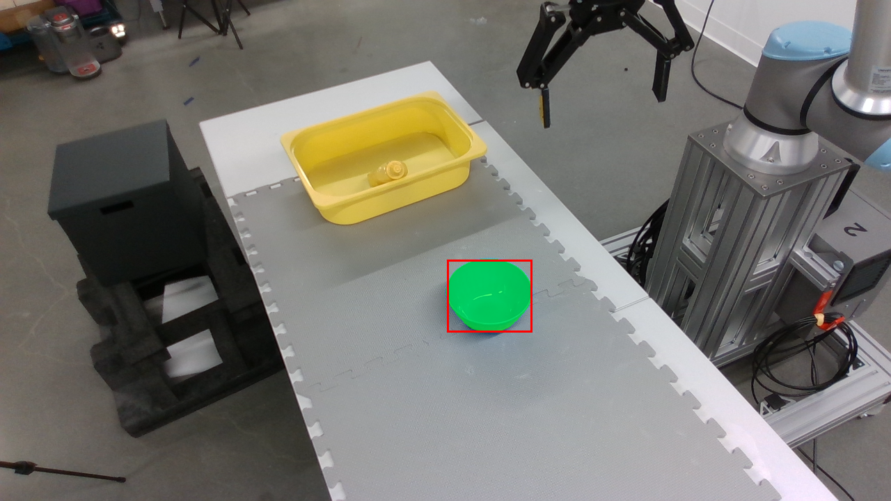

# GraspGen 官方样例硬件可行性测试

测试日期：2026-10-03。30 次推理和 1 次分割集成测试均完成，无显存溢出。

## 测试环境与范围

- GPU：NVIDIA GeForce RTX 4070 Laptop GPU，可见总显存 8188 MiB；Windows WDDM。
- Python 3.12，PyTorch 2.11.0+cu128，CUDA 12.8；使用原生 Windows。
- 上游提交：`2dd8852e1be60f5f9d277fafcc621835cdf59110`。
- 作者 Robotiq-2F-140 预训练权重，PointNet++ 编码器，FP32，10 步扩散；未训练或微调。
- 官方真实物体点云：`data\sample_data\real_object_pc\1740787710_319213.json`，7674 个输入点。
- 分割：沿用已有 SAM2 Hiera Large 权重，BF16；不启用可选 CUDA 后处理。

## 30 次推理结果

每个候选预算先预热 1 次，再连续计时 10 次。各预算复用种子 1000–1009。
计时含目标点云去噪、扩散生成和判别器评分，排除模型加载、文件读入、分割、碰撞过滤与可视化。
只进行一次生成，不使用补采重试，也不使用默认 top-100 截断。0.8 阈值仅用于统计评分通过数量。

| 候选预算 | 次数 | 平均耗时（秒） | 耗时范围（秒） | 原始输出 | 评分≥0.8 平均数（范围） | PyTorch峰值申请（MiB） | PyTorch峰值预留（MiB） | 整卡峰值占用（MiB） |
|---|---|---|---|---|---|---|---|---|
| 50 | 10 | 0.2802 | 0.2768–0.2833 | 每次50 | 25.0（18–29） | 470.8 | 480.0 | 2108.7 |
| 100 | 10 | 0.2846 | 0.2803–0.2888 | 每次100 | 54.4（45–61） | 470.8 | 484.0 | 2112.7 |
| 200 | 10 | 0.2859 | 0.2740–0.2931 | 每次200 | 111.4（103–121） | 470.8 | 484.0 | 2112.7 |

PyTorch峰值申请包含常驻模型；预留包含缓存。整卡占用由 NVML 每 20ms 采样，含桌面及其他进程，不是本进程独占显存，且可能漏过极短峰值。
候选数量增加但峰值申请基本不变，在本样例中，7674 点去噪的两两距离矩阵贡献了较大的中间分配；本次数据不代表更大点云也只占用同样显存。
模型加载耗时 4.890 秒，单独记录，不计入上述推理结果。

## 分割到避碰的集成测试

官方场景 `1745619598_467125.json`，1280×720 RGB，目标是蓝色碗。
框提示由样例给出的目标点云匹配到原始像素得到，模拟用户选择目标。SAM2输出真实参与点云提取，没有直接沿用作者目标点云作为推理输入。
使用样例已有的逐像素世界坐标XYZ；没有猜测相机内参，也没有额外估计深度。

流程：SAM2框提示分割 → 利用掩膜提取XYZ → GraspGen生成100个候选并评分 → 0.8阈值 → 场景碰撞过滤。

| 阶段 | 耗时（秒） |
|---|---|
| SAM2分割 | 0.5986 |
| 点云提取与传输 | 0.0172 |
| 抓取生成与评分 | 0.4669 |
| 碰撞过滤 | 0.1121 |
| 全流程墙钟时间（含阶段间处理） | 1.2028 |

- SAM2掩膜 10087 像素；有效目标点云 4894 点。
- 输出 100 个原始候选，评分通过 53 个，碰撞过滤后保留 8 个。
- 两模型同时驻留。PyTorch峰值申请 1686.9 MiB，峰值预留 2182.0 MiB，整卡峰值占用 3817.9 MiB。
- 文件读入和提示准备另外耗时 1.275 秒；SAM2加载 1.881 秒，GraspGen加载 3.734 秒；均未计入计算流程。
- 碰撞参数：20mm距离阈值、8192个场景点、2000个夹爪表面点，GPU批量4。该阈值沿用官方默认值，并非传感器准确度或保证安全的界限。
- 与作者提供的分割点云在有效深度像素上的对应一致度为 0.9941；这是同一样例的一致性检查，不能作为独立分割基准结果。



## 可以得出的结论

当前 RTX 4070 Laptop 8GB 足以运行这套 PointNet++ 预训练推理与单视角分割/碰撞流程。在此规模下，显存不是立项障碍。
该测试尚未验证多视角配准、接近路径碰撞、机械臂可达性、物理抓取稳定性或论文主实验指标。评分通过数量不等于成功抓取次数。

## 兼容性改动与复跑

- 延迟导入本次未使用的PTv3编码器，避免它的spconv/torch_scatter依赖阻止PointNet++模型加载。
- PointNet++扩展改用MSVC编译选项和Conda CUDA库路径；CUDA流与设备守卫改用等价c10命名空间，去掉未使用的BLAS头文件依赖。未修改采样、分组或插值内核。
- Windows链接使用`/MANIFEST:NO`，绕过当前资源编译器子进程调用问题。
- 兼容改动见`windows_compat.patch`和`prepare_windows.py`。使用作者权重，模型架构和扩散步数未更改。
- 本项目虚拟环境复用电脑已有的CUDA PyTorch等包，新增依赖装在本项目`.venv`；不能把这个虚拟环境目录当作可移植发布包。

在 `D:\3D_Vision` 的 PowerShell 中执行：

```powershell
.\projects\graspgen_feasibility\.venv\Scripts\python.exe projects/graspgen_feasibility/benchmark.py
.\projects\graspgen_feasibility\.venv\Scripts\python.exe projects/graspgen_feasibility/pipeline_benchmark.py
.\projects\graspgen_feasibility\.venv\Scripts\python.exe projects/graspgen_feasibility/write_report.py
```

原始逐次记录：`runs/inference_trials.csv`；完整元数据：`runs/inference_summary.json`和`runs/pipeline_summary.json`；模型文件校验：`data/download_manifest.json`。

来源：[GraspGen官方代码](https://github.com/NVlabs/GraspGen)、[作者模型与样例](https://huggingface.co/adithyamurali/GraspGenModels/tree/main)。
