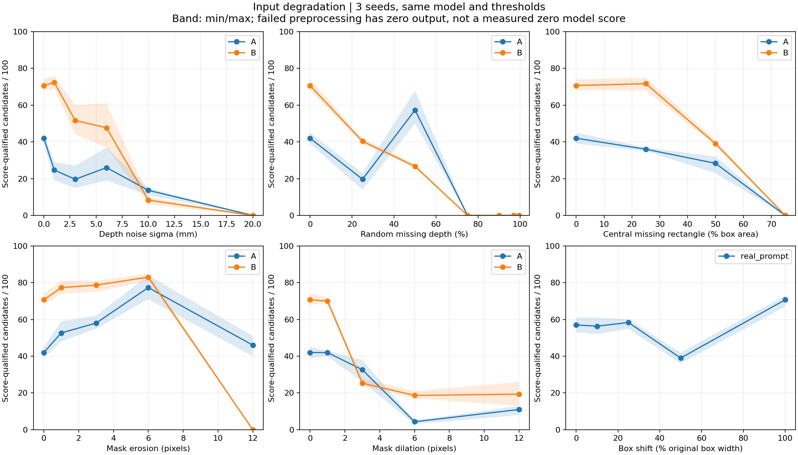
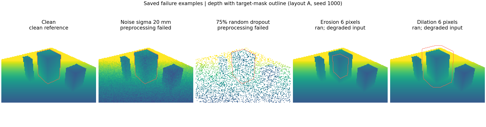
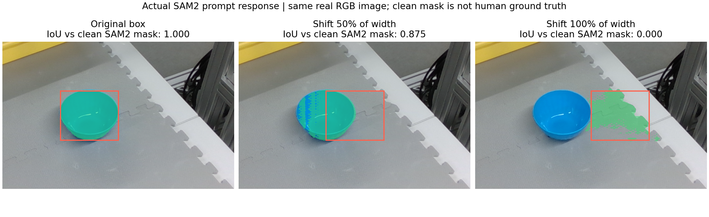
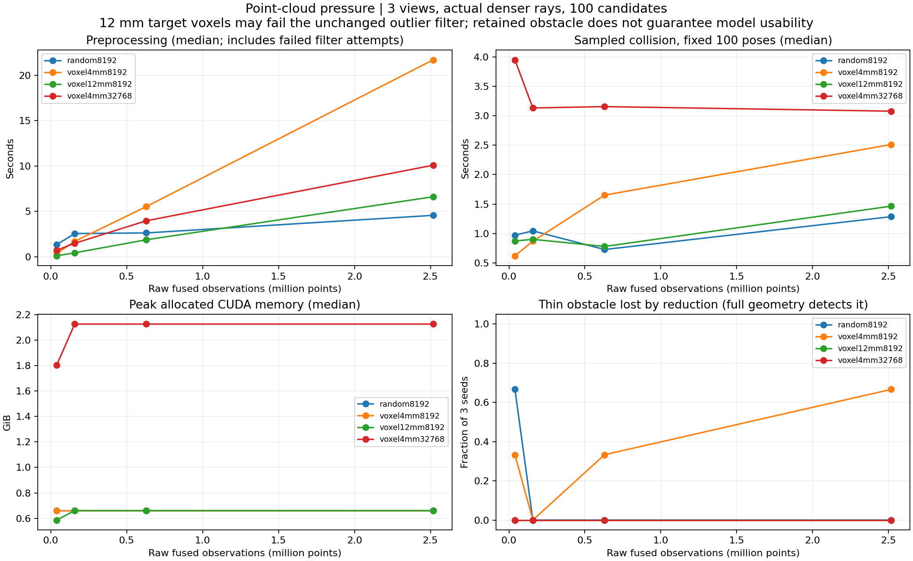
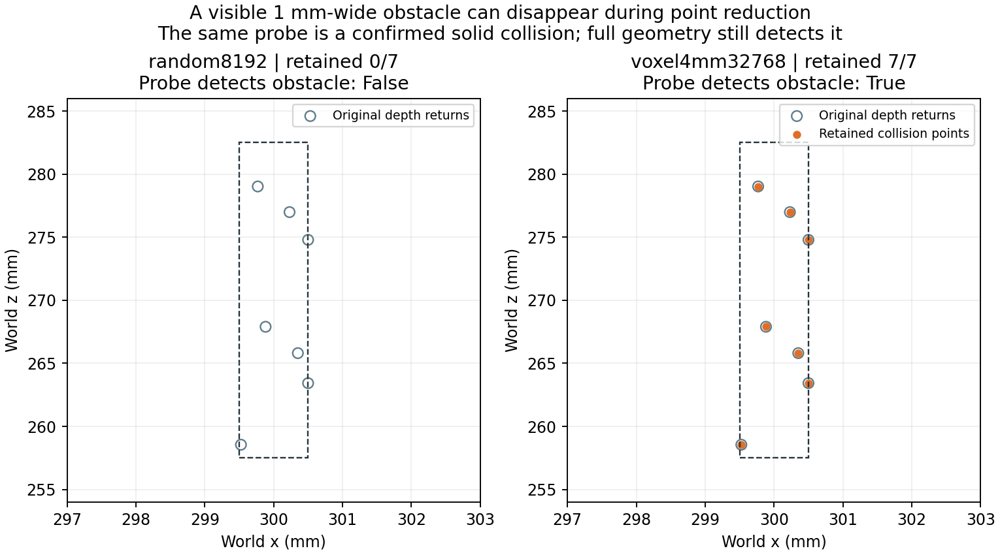

# 准备实验5、6：输入退化鲁棒性与融合点云规模

实验数据于2026-10-05生成，2026-10-06完成汇总核验。本报告记录已有合成场景与官方真实照片样例上的准备实验，不替代真实相机和机器爪验收。鲁棒性产物位于 `runs/robustness/prehardware_20261005/`，压力测试产物位于 `runs/pointcloud_stress/prehardware_20261005/`。

两项共207组实验已完成：159组输入鲁棒性、48组点云压力测试。50项单元测试及全部产物核验通过。实验保留51次预处理中止；核验通过表示记录和计算一致，不表示每种输入或方案都成功。

## 实验5：完成159次输入退化试验

两个已有合成布局A/B，各使用第2视角，分辨率160×120。每次只改变一类输入；模型、评分阈值、离群点过滤、碰撞余量及观测参数固定。每个条件使用1000、1001、1002三个种子，每次请求100个候选；预处理失败时记录中止，不重试、不替换输入。共138次合成场景试验，以及真实照片7种框提示×3个生成种子的21次试验。

合成场景分别改变：

- 深度噪声：有效光轴深度加入零均值高斯噪声，标准差1、3、6、10、20毫米；不填补原来的无效深度。
- 随机缺点：删除25%、50%、75%、90%、97%、99.5%的有效深度像素。
- 成片缺失：删除目标框中心面积为原框25%、50%、75%的矩形区域；记录实际剩余目标点数，矩形面积比例不等于目标表面缺失比例。
- 分割侵蚀/膨胀：用3×3方形结构元素处理1、3、6、12次，对应每次向边缘内缩/外扩约1像素。RGB及几何保持不变，改变的是目标/背景标签。

真实照片使用实际SAM2模型：框向右移动原宽度的10%、25%、50%、100%，以及宽高同时缩至50%或放大至150%。每种提示分割一次，再用三个种子生成抓取；不能把三个生成种子当成三次独立分割。原照片只有世界XYZ，缺少射线标定，因此这一部分仅评价分割稳定性和几何筛选，不认证未知空间。

### 预先确定的明显退化条件

协议在运行前保存。满足任一条件即标记，并保留具体原因：流程中止；掩码IoU低于0.70；模型输入点到干净目标观测点的距离P95超过10毫米；6毫米邻域覆盖低于同种子干净输入的一半；评分合格候选低于干净输入的一半（基线至少10个）；固定干净候选的连续几何接近判定改变超过20%。

合成掩码来自解析可见目标，真实照片的参照是干净框下的SAM2掩码，后者**不是人工真值**。点云距离和覆盖参照干净的可见目标点，不能解释为完整物体表面的测量精度。

另用原始夹爪三角网格与真值实体盒做独立连续碰撞评价，真值不参与输入处理或筛选。固定候选复查保持干净输入生成的姿态不变，用于区分输入几何改变与生成器候选改变；此处固定复查指标针对连续几何接近检查。

### 实测退化边界

| 退化类型 | 本次观察到的明显影响 | 直接中止的位置 |
|---|---|---|
| 深度噪声 | 标准差10mm时A/B各3次均明显退化；A在3mm时已出现2/3次候选数量不足一半，且不同档位不严格单调 | 标准差20mm时两布局共6次均因过滤后目标点不足而中止 |
| 随机缺点 | 删除50%时两布局共6次均明显退化；A在25%已有2/3次触发条件 | 删除75%及更高档位时两布局均中止 |
| 中央成片缺失 | 矩形面积50%时两布局均明显退化 | 面积75%时两布局均中止 |
| 掩码侵蚀 | A从6像素、B从3像素起，三个种子均触发退化 | B侵蚀12像素时目标有效点不足100；A在该档位仍能运行，但输入形状已严重退化 |
| 掩码膨胀 | A从6像素、B从3像素起，三个种子均触发退化 | 本次1–12像素范围均能运行，能运行不代表目标点云正确 |

这些是测试过的离散档位，不是相机容许误差的精确边界，也不是新设备的通用参数。尺度、分辨率、物体大小和初始点密度变化都会改变结果。

159次中，39次因目标点数不足100或离群点过滤后剩余点过少而中止；99次触发至少一条明显退化条件，包含上述39次。这是有意选择退化输入的实验集合，比例不能当成真实场景故障率。

一个容易误判的例子：布局B侵蚀6像素后，掩码IoU约0.392，三个种子的高评分候选反而达到81/83/85个，而干净输入只有70/68/74个；最终几何筛选全部拒绝。目标变小、形状错误时，模型仍可能给出更多高分。





### 框提示失败：可能抓错目标而仍然通过几何筛选

| 框变化 | 与干净SAM2掩码的IoU | 三个种子的评分合格候选 | 三个种子的几何保留候选 |
|---|---:|---|---|
| 原框 | 1.000 | 53 / 61 / 57 | 5 / 7 / 10 |
| 右移10%宽度 | 0.998 | 52 / 61 / 56 | 6 / 7 / 9 |
| 右移25%宽度 | 0.977 | 55 / 60 / 60 | 6 / 8 / 12 |
| 右移50%宽度 | 0.875 | 36 / 39 / 42 | 2 / 5 / 7 |
| 右移100%宽度 | **0.000** | **72 / 73 / 67** | **0 / 1 / 2** |
| 宽高缩至50% | 0.451 | 53 / 48 / 54 | 0 / 0 / 0 |
| 宽高放大至150% | 0.963 | 17 / 27 / 24 | 1 / 1 / 2 |

右移一个框宽后，绿色分割转到了碗旁的垫子区域，已经不是原蓝碗。评分及碰撞检查仍可能留下候选。实验评价器能借助干净目标参照指出这次失败；**当前正式推理入口没有因此自动获得目标身份校验能力**。这项结果要求以后加入目标确认或跨帧身份检查，不能靠几何碰撞筛选解决抓错目标的问题。



### 筛选结果的限制

所有成功运行的合成退化组累计有517个候选通过评分、终点及连续几何检查，其中75个与独立实体参考存在碰撞。观测门控后合成组均未放行，干净基线也未放行。因此不能用最终“0个漏放”宣称系统已可靠；参考可行候选同样没有留下。此统计是本次生成候选上的结果，不能与之前固定候选的碰撞实验直接比较。

## 实验6：融合点云规模压力测试

使用之前布局A的3个已知位姿，加入1×1×25毫米细柱。相机分辨率从160×120逐级提高到320×240、640×480、1280×960；每档重新发射更多像素射线，未靠复制旧点增加规模。已知位姿下拼接完整观测点，相机配准正确性属于此前实验，配准和深度生成/文件导出不计入本次点云处理时间。

比较4种方案，各3个种子、每次100候选，共48次：目标随机最多8192点/背景最多8192点；4mm体素后同样限量；12mm体素后同样限量；4mm体素后目标最多8192点、背景提高至32768点。目标与背景分别处理。所有方案保持相同的K=20、平均邻域L1距离14mm离群点过滤阈值，专门观察采样方式与现有参数是否兼容。

除了实际生成候选的碰撞耗时，还用每个种子固定的100个干净候选比较GPU终点碰撞耗时，避免候选数量变化影响比较；另用其中固定6个候选测完整原始几何的连续接近耗时。细柱使用单独的终点探针：独立实体参考确认它碰到细柱，且不会碰到其他盒体；同时确认移除细柱观测后，2mm余量下的点几何检查也不碰其他表面。

细柱探针采用凸部件对点的几何检查，隔离“场景点被删掉”的影响；它不使用抽样夹爪表面，避免混入另一种采样漏检。GPU抽样终点碰撞的耗时另外记录。

完整几何始终保留在CPU；推理和GPU抽样碰撞的点数单独限制。计时前模型加载并预热，计时阶段同步GPU，记录各阶段CUDA已分配/保留峰值与NVML整卡采样值。CUDA峰值包含常驻模型，NVML还包含桌面及其他进程。三个重复的耗时只代表本机准备实验，后台负载没有完全隔离。

### 规模、耗时与显存

| 单视角分辨率，均为3视角 | 完整观测点数 | 细柱原始观测点数 | 随机8192方案：完整几何检查固定6候选，中位秒数 |
|---|---:|---:|---:|
| 160×120 | 39,336 | 7 | 0.23 |
| 320×240 | 157,342 | 32 | 1.25 |
| 640×480 | 629,488 | 131 | 5.34 |
| 1280×960 | **2,517,731** | 528 | **19.95** |

48次中有36次完成抓取推理；12次均为12mm体素方案在所有分辨率下过滤后目标点不足，未发生显存耗尽。随机限量和两种4mm方案在所有尺度均完成推理。证明的是“完整输入保留、送入模型与GPU碰撞的点数有上限”的流程可运行，不是将全部252万点直接送入生成模型。

以下均为最大规模2,517,731点的结果。耗时取3次中位数；总显存取这3次的最大CUDA已分配峰值，含常驻模型及各计时阶段。

| 方案 | 推理完成 | 预处理秒 | 生成100候选秒 | 固定100候选抽样碰撞秒 | 最大CUDA已分配MiB |
|---|---:|---:|---:|---:|---:|
| 随机限量8192 | 3/3 | 4.56 | 0.615 | 1.286 | 676.52 |
| 4mm体素后限量8192 | 3/3 | 21.70 | 0.566 | 2.513 | 676.52 |
| 12mm体素后限量8192 | 0/3 | 6.61，过滤失败 | 未执行 | 1.464，仅固定探针 | 676.52 |
| 4mm体素，背景提高至32768 | 3/3 | 10.08 | 0.432 | 3.079 | 2177.27 |

阶段显存同样已独立记录。最大尺度下，成功方案预处理峰值约510.81MiB、生成阶段约197.24MiB；背景8192点的碰撞阶段约676.52MiB，背景32768点约2177.27MiB（2.13GiB）。12mm方案预处理约182.42MiB，没有生成阶段；其总峰值来自额外的固定候选碰撞试验。CUDA保留峰值和NVML整卡峰值也保存在每组 `performance.json` 中，不能把PyTorch已分配量等同于整卡总占用。

耗时波动明显：最大尺度下4mm/8192的预处理范围为8.74–22.13秒，4mm/32768为7.77–13.82秒。方案按固定顺序执行，只有3次重复且后台负载未完全隔离，不能据中位数差异认定“背景点更多反而更快”。完整几何检查固定6个候选已需约16–21秒；当前百万点全量接近检查尚不适合实时交互。

详细分组统计及最小/中位/最大耗时在 `resource_summary.json` / `resource_summary.csv`，其中也有实际生成后评分合格候选的碰撞耗时。表中选择固定100候选这一列用于可比性更好的对照，不把不同候选数量混为同一工作量。



### 小障碍是否丢失

| 方案 | 四档规模×3种子中细柱丢失 | 最大规模细柱丢失 | 解释 |
|---|---:|---:|---|
| 随机8192 | 2/12 | 0/3 | 最低分辨率仅7个细柱点，2次被全部删掉 |
| 4mm体素后限量8192 | 4/12 | 2/3 | 体素保留了局部结构，随后再次限量仍可能删除细柱 |
| 12mm体素后限量8192 | 0/12 | 0/3 | 细柱保留，但目标点预处理全部失败，不能视为可用方案 |
| 4mm体素，背景32768 | 0/12 | 0/3 | 本次细柱保留更稳定，显存和碰撞工作量增加；不构成对任意障碍的保证 |

6次丢失案例中，完整几何探针均检出碰撞，处理后的点集均未检出；对应输入及碰撞子集已保存。增加总点数或使用体素并不能自动保证细小障碍留下。后续工程应继续保留完整观测几何用于最终复核，推理点数单独限制；若要加速全量检查，需要另行验证空间索引等改动不会丢失障碍。



## 当前可执行结论与未完成的真机范围

- 目标身份、掩码完整性与抓取评分分别评价；已经保存“抓错目标仍有高分”的失败样例，正式入口尚需目标身份确认机制。
- 缺点或体素化改变了点密度，现有固定邻域过滤可能将正常稀疏表面也当成离群点；12mm体素不能直接配合当前参数投入使用。
- 252万原始观测点在限量推理方案下可以运行，主要扩展瓶颈是CPU预处理和完整几何接近检查。当前未宣称实时或真实抓取成功率提升。
- 硬件到手后仍需按实际相机的噪声、深度缺失形态、尺度、内外参误差重新标定阈值；本次未测试动态物体、混合退化、真实设备连续采集或闭指抓取。

产物核验记录为 `runs/preparation_56_verification.json`，覆盖输入/源码一致性、掩码及候选记录、固定候选判定、失败保留、点数预算、小障碍计数及性能字段。图表已逐张检查。

## 复跑入口与失败样例

在项目目录PowerShell中运行，默认生成新目录，不覆盖已有实验：

两个入口默认读取此前 `prehardware_v2_20261005` 场景。新环境若没有该目录，先运行 `visibility_fusion_experiments.py --output runs/visibility_fusion/prehardware_v2_20261005`；已有环境不需重建。真实照片框提示实验还依赖现有官方样例、SAM2与GraspGen权重。

```powershell
.venv\Scripts\python.exe robustness_experiments.py
.venv\Scripts\python.exe pointcloud_stress_experiments.py
.venv\Scripts\python.exe -m unittest discover -s tests -p "test_*.py"
.venv\Scripts\python.exe -m tests.verify_preparation_56 --robustness runs/robustness/prehardware_20261005 --stress runs/pointcloud_stress/prehardware_20261005 --report runs/preparation_56_verification.json
.venv\Scripts\python.exe summarize_preparation_56.py runs/pointcloud_stress/prehardware_20261005
.venv\Scripts\python.exe plot_preparation_56.py --robustness runs/robustness/prehardware_20261005 --stress runs/pointcloud_stress/prehardware_20261005
```

鲁棒性目录中每个案例保留 `input/scene.json`、退化深度/掩码、`result.json`、`evaluation.json` 和 `arrays.npz`；生成成功时另有完整候选JSON/CSV。真实框提示输入在其种子目录的上一层，另保存SAM2掩码与分割性能。失败也有耗时、原因和输入，不补造未生成的候选。

典型失败输入：`synthetic/A/noise_0.02/1000/input/scene.json`、`synthetic/A/dropout_0.75/1000/input/scene.json`、`synthetic/B/erode_12/1000/input/scene.json`、`prompts/box_shift_1/input/scene.json`。可交给 `analyze_scene.py --input ... --seed 1000` 单独重放；真实XYZ框提示样例另加 `--no-observation`，与本次几何评价范围一致。

压力目录每档保存完整观测点、像素标签与深度，每种方案保存模型点、碰撞子集、候选及分阶段性能；`final_only_candidates.json` 明确标记只到抽样终点检查，不授权实际规划或执行。
