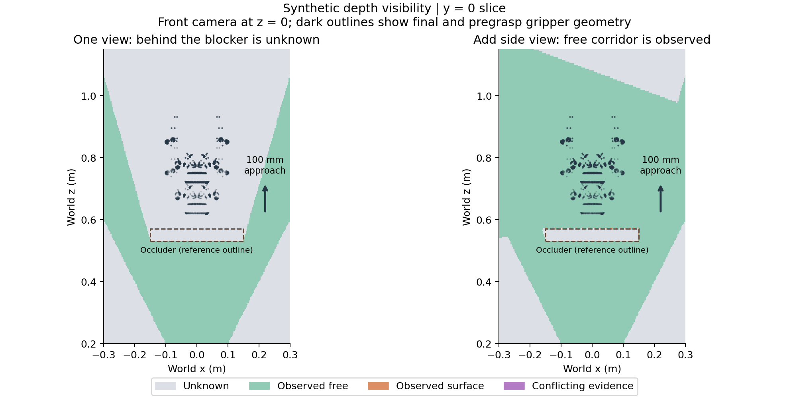
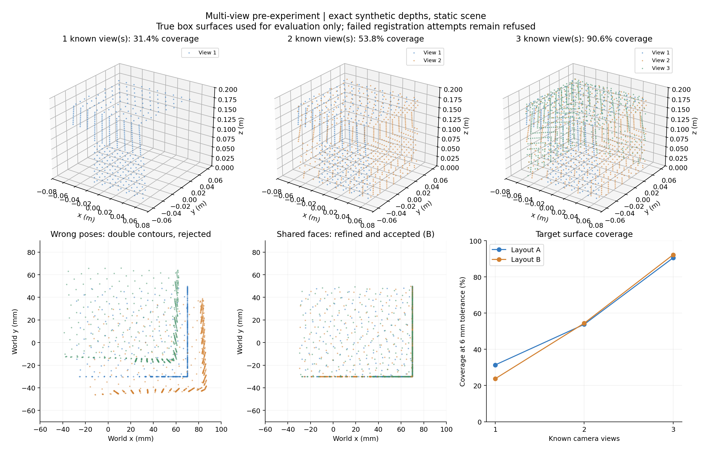

# 准备实验3、4：遮挡与未观测区域、多视角融合

完成日期：2026-10-05。代码、合成深度输入、逐候选/逐视角结果、图表和复核工具均已保存。当前正式结果为 `runs/visibility_fusion/prehardware_v2_20261005/`。首轮 `prehardware_20261005/` 保留作历史记录；当前版本纠正了其边缘法向导致的虚假配准约束，不能继续引用首轮的配准成功结论。

## 结论

- 已实现空闲、观测表面、未知、观测冲突四种状态。物体背后、图像外、相机后方和无效深度不再当作空闲。
- 已把观测检查接入离线候选筛选，默认开启；穿过关键未知区域时输出“观测不足，需要补拍”，拒绝放行。
- 遮挡实验9项均符合预期。相同通道从单视角的全部未知，变成补充侧视角后的全部可观测空闲；如果遮挡后确有障碍，侧视角会发现观测表面并继续拒绝。
- 两个静态布局的1/2/3视角已知位姿融合都成功。参考目标表面采样点覆盖率从23.8%–31.4%增加到90.6%–92.3%。
- 故意错位的融合、重叠不足、纯平面配准及大位姿误差均被拒绝。原视角组合缺乏可靠的共同侧面约束，4组小误差配准均拒绝；新增共享三个表面方向的视角组合后，A/B两视角、三视角的4组修正均成功。
- 45项单元测试和实验产物独立复核通过。26组融合实验有22组达到预期，4组是原视角组合未成功恢复的案例，原始预期未改写；另有纯平面退化拒绝实验。实验完成不等于所有配准成功。
- 新增 `recheck_fused_scene.py`，已跑通“通过质量检查的融合结果 → 同一批已有抓取候选复查”。已知位姿与修正位姿各复查100个候选，身份、评分和相机修正均可追溯；当前仍无最终放行候选。

本次使用无噪声合成深度和准确目标掩码，是功能与几何准备实验。未做真实相机标定、噪声鲁棒性、动态场景或实物抓取验收。

后续已完成独立的输入退化及点云压力准备实验，见 [ROBUSTNESS_STRESS_RESULTS.md](ROBUSTNESS_STRESS_RESULTS.md)；其结果不改变本文无噪声实验的适用范围。

## 实验3：让系统区分“看见的空处”和“没看见”

实现：`offline_core/observation.py`；深度载入：`offline_core/scene_io.py`。

`DepthView` 保留米制光轴深度、对应分辨率内参、OpenCV相机约定和 `T_world_camera`。沿相机射线，在深度返回值前方且留有容差的区域是已观测空闲；返回值附近是观测表面；返回值后方是未知。无效深度或图像外同样未知。

合并视角时，一个视角的空闲证据可以补充另一个视角的未知区域；如果同一位置同时获得空闲和表面证据，则记为冲突，不能让空闲标签覆盖冲突。多视角位姿必须先通过融合检查。

对整条接近段的处理：

1. 延用已验证的Robotiq开放夹爪、局部+Z、100mm固定朝向直线接近。
2. 给每个凸部件的连续扫掠体生成8mm体素外包络，保留指间空隙；用包含整个体素的球形包络处理任意世界朝向。本次夹爪共4354个包络体素。
3. 将每个包络投影到深度图，检查其完整像素覆盖范围，而不是只看体素中心或稀疏路径点。只有整个范围都位于有效返回值之前，才能认证为空闲。深度容差2mm。
4. 任一包络仍未知则保存未知数量、比例、示例世界坐标和补拍提示。包络与观测表面相交或视角证据冲突时也拒绝。

上述是相对于离散针孔深度模型的保守检查。像素内深度近似、8mm包络、2mm容差和相机位姿精度都限制真实适用性；“包络附近有表面”不等于原始精细网格必然碰撞。它也会额外拒绝靠近目标的方案。

合成器 `experiments/synthetic_depth.py` 用解析射线/实体盒交点生成160×120光轴深度，选择最近正交点，真实产生遮挡；没有把隐藏表面直接交给观测模块。独立实体碰撞参考沿用实验1、2的原始三角网格连续参考。

| 用例 | 视角 | 结果 | 未知包络体素 |
|---|---:|---|---:|
| 空闲通道 | 1 | 已观测空闲 | 0/4354 |
| 被挡板遮住、实际空闲 | 1 | 观测不足，补拍 | 4354/4354 |
| 同一通道增加侧面视角 | 2 | 已观测空闲 | 0/4354 |
| 隐藏指部障碍 | 1 | 观测不足，补拍 | 4354/4354 |
| 隐藏障碍增加侧视角 | 2 | 包络附近发现表面，拒绝 | 186/4354，另有表面证据 |
| 中央深度缺失 | 1 | 观测不足 | 4346/4354 |
| 接近段在视场外 | 1 | 观测不足 | 4354/4354 |
| 夹爪接近段被实体完全包围 | 1 | 观测不足，拒绝 | 4354/4354 |
| 无标定深度 | 0 | 缺少标定，无法认证 | 未建立包络判断 |

“实体包围”用例说明：看不到附近表面时现在会拒绝放行，但拒绝理由是没有空闲证据，不是推断出了完整隐藏物体。此前实验1、2仅有全表面点云，不可凭空补造其相机内外参。



## 实验4：已知位姿融合、位姿误差与拒绝

实现：`offline_core/fusion.py`；命令入口：`fuse_scene.py`。

两个布局A/B均包含桌面、盒形目标、部分遮挡物和不对称邻近物。每个布局保留原3视角组合，并新增一组共享三个表面方向的3视角组合，场景完全静止。所有输入都保存为现有规范 `scene.json`、`depth.npy`、RGB和目标掩码，并通过真实 `load_scene` 接口回读。

先用已知位姿做1/2/3视角融合，再将世界坐标误差变换左乘到第2、第3相机位姿：第2视角平移 `[16,-12,6]` mm，XYZ欧拉角 `[1,-1,2]` 度；第3视角 `[-12,14,-4]` mm、`[-1,1,-1.5]` 度。由于包含绕世界原点的旋转，这些平移分量不等于相机中心的总偏移。另有大误差、60cm平移造成的低重叠及纯平面退化用例。

配准与拒绝机制：

- 第一视角固定为世界锚点；后续视角按顺序对前面视角做点到平面ICP。局部法向来自组织化深度，相邻深度跳变区域被剔除。新增3×3邻域法向稳定性检查：相邻法向点积至少0.995，避免把跨越两个面的混合法向当成真实平面。
- 最近邻对应还要满足表面方向一致，避免把物体不同面互相匹配；对应半径45mm、每点最多12个近邻、法向点积至少0.95，剔除最远10%对应。
- 检查约束矩阵最小/最大奇异值比，低于0.001时拒绝；纯平面即使残差为0也不能认为相机姿态已经确定。
- 最多35次迭代；未稳定收敛、对应不足，或修正超过50mm/8度都拒绝。
- 对所有视角做双向深度重投影，排除深度边缘及确实被遮挡的点。可见表面落入另一视角的已观测空处，或可见重投影差过大，标记为“双重轮廓或深度冲突”。同时检查整体与目标区域，避免桌面主导统计而掩盖目标错位。
- 重投影P90阈值8mm，空闲证据冲突比例阈值5%；最低场景/目标证据分别100/30点；12mm近邻距离下双向重叠最低20%。这些是准备实验参数，未针对真实设备校准。

真值盒几何和真相机位姿只进入评价函数，不参与ICP或拒绝判定。开发过程中先增加对应法向约束，继续排查未收敛案例时发现边缘法向会虚构额外约束，因而新增局部法向稳定性检查。原正前方锚点只有桌面和前侧面两类可靠平面，无法确定沿剩余方向的滑动；背面视角共享面更少。保留原18组及原预期，新增8组有共同侧面的控制实验，未为提高通过率放宽阈值。这两个布局都是开发性实验，不冒充独立留出测试集。

融合时目标和背景分开体素化，4mm体素内取质心。完整观测点也保留，每个点都有来源视角和图像像素；每个融合体素保存来源视角位集合与观测数量。推理输入的点数预算仍应单独控制，不以丢弃完整碰撞几何作为代价。

未通过检查时只导出 `fusion_diagnostic.npz` 和原因，**不导出** `fusion_usable.npz` 或 `accepted_depth_views.npz`；API的 `usable_cloud=None`、`usable_views=[]`，用于阻止继续规划。通过后同时保存深度证据和修正后的内外参，以便继续做多视角空闲/未知判断。

## 融合结果与误差

覆盖率定义为：完整目标盒表面上4mm网格采样点中，到融合观测点的距离不超过6mm的比例。包括底面参考点，因此不能达到任意视角下的100%；6mm邻域也会覆盖到实际未直接看见的边缘附近。该指标不是精确可见表面积比例。

| 已知位姿输入 | 布局A覆盖率 | 布局B覆盖率 | A最大尺寸误差 | B最大尺寸误差 |
|---|---:|---:|---:|---:|
| 1视角 | 31.40% | 23.77% | 6.961mm | 6.961mm |
| 2视角 | 53.80% | 54.43% | 0.371mm | 0.316mm |
| 3视角 | 90.56% | 92.28% | 0.035mm | 0.316mm |

尺寸误差是融合目标轴对齐包围盒三个边长与已知目标尺寸的最大绝对差。单视角约7mm偏差主要来自没有看到完整边界；多视角补充后尺寸接近真值。这些小误差来自理想合成深度，不能解释为真实相机精度。

| 注入小误差后的输入 | 当前结果 | 最大相机位置误差 | 最大相机旋转误差 | 最大目标尺寸误差 |
|---|---|---:|---:|---:|
| 原A，2视角 | 几何约束退化，拒绝 | 22.302mm | 2.457° | 17.000mm |
| 原B，2视角 | 几何约束退化，拒绝 | 22.302mm | 2.457° | 16.582mm |
| 原A，3视角 | 几何约束退化，拒绝 | 32.564mm | 2.457° | 35.613mm |
| 原B，3视角 | 几何约束退化，拒绝 | 32.564mm | 2.457° | 33.690mm |
| 共享侧面A，2视角 | 修正并接受 | <0.001mm | <0.00001° | 0.169mm |
| 共享侧面A，3视角 | 修正并接受 | <0.001mm | <0.00001° | 0.169mm |
| 共享侧面B，2视角 | 修正并接受 | <0.001mm | <0.00001° | 0.402mm |
| 共享侧面B，3视角 | 修正并接受 | <0.001mm | <0.00001° | 0.365mm |

极小的相机误差来自无噪声解析平面和浮点数精度，不能解释为真实设备能达到这一标定精度。共享侧面组合三视角覆盖率仅为A 54.51%、B 50.91%，低于已知位姿绕到背面的90%以上：容易配准和覆盖更多表面是两个不同要求。

未经修正的三视角错误融合，使A/B目标最大尺寸误差达到35.613/33.690mm，并出现双重轮廓；两者均被深度一致性门控拒绝。未经修正的两视角、大误差和低重叠也全部被拒绝。

首轮A三视角虽然点到平面残差很小，真实位置仍错约15mm且迭代振荡。进一步检查发现，首轮另外3组“成功”也依赖不可靠的边缘法向；新版将这些案例统一识别为约束退化并拒绝。历史输出保留，但首轮配准成功结论已撤回。硬件采集时应保证共享不同方向的真实表面，或提供可靠外部标定；不能仅凭很小的残差认定位姿正确。



## 系统集成、验证与当前范围

- `Scene` 对深度输入保留 `depth_view`；旧逐像素XYZ输入没有足够的射线标定时，不猜测内参，也不据此认证空闲。
- `analyze_scene.py` 默认启用 `observation`。候选JSON记录状态、提示、未知比例和示例点；CSV/NPZ也保存观测状态。`--no-observation` 可复现前一轮仅几何接近检查；`--no-approach` 默认同时关闭观测检查。
- 对布局A第2视角跑通完整抓取链路：100候选、42个评分/姿态合格，旧终点筛选保留19个、加接近几何后11个，新观测检查最终保留0个。42个都存在未知包络，41个另有保守包络附近的观测表面。观测阶段约0.564秒。这表明当前单视角及包络参数较保守，不能把功能跑通解释为已经提高实际可规划率。
- 已知三视角融合CLI输出可用点云；错误位姿CLI输出拒绝原因且没有可用点云文件。所有输出目录必须为空，防止拒绝运行残留上一轮可用产物。
- 45项单元测试通过，覆盖前述功能，并新增边缘法向不能虚构平面、来源相机修正、目标/世界坐标/标定/掩码不匹配拒绝、深度文件变更拒绝和拒绝结果残留文件隔离。
- `verify_visibility_fusion_experiments` 已复核源码哈希、所有原始点的来源像素/修正位姿、拒绝输出隔离、覆盖率/尺寸统计以及被接受的配准误差，结果为通过。原始实验中的4个未成功恢复案例仍保留在汇总中。

当前主抓取入口仍是一份单视角场景；`fuse_scene.py` 输出经检查的多视角融合，新增 `recheck_fused_scene.py` 使用融合结果复查原来生成的候选。还没有把融合目标重新送入生成模型、做完整单/多视角抓取效果对照或构建实时界面。

## 补拍融合后复查同一批候选

复查入口验证融合接受标志、输出文件哈希、同一目标/世界坐标，以及原候选场景与融合来源中的一份输入完全匹配（包括标定、深度、RGB和目标掩码哈希）。来源不符或融合被拒绝时，不导出复查候选。

候选ID、模型评分与原夹爪表面采样保持不变；若来源相机经过修正，将 `T_corrected_camera × inverse(T_original_camera)` 左乘到全部候选，避免点云修正了而候选留在旧位置。终点检查采用原夹爪采样和相同距离阈值，但使用完整融合背景和CPU最近邻；接近检查使用完整观测目标/背景，观测检查使用接受后的所有深度视角。原拒绝原因重新计算。

| 链路 | 原候选数 | 评分/姿态合格数 | 单视角未知包络累计数 | 三视角未知包络累计数 | 最终放行 |
|---|---:|---:|---:|---:|---:|
| 已知位姿融合 → 复查 | 100 | 42 | 153525 | 128885（减少16.05%） | 0 → 0 |
| 来源带误差 → 配准 → 修正候选 → 复查 | 100 | 51 | 181585 | 169292（减少6.77%） | 0 → 0 |

累计数会重复统计不同候选覆盖的同一空间，不是独立空间体积。第一条链路42个候选仍都有未知包络；第二条51个同样如此。多视角还使部分包络出现表面/空闲证据冲突；离散像素和保守包络也会触发此状态，不能单凭它断言相机错位。当前参数仍保守，因此只能证明链路和拒绝逻辑有效，不能宣称已提高可规划率或真实抓取成功率。

`tests.verify_fusion_recheck` 通过两条完整链路的JSON/CSV/NPZ一致性、身份/评分保留、来源相机修正和文件哈希复核，并实际调用命令确认拒绝融合无法输出候选。记录在 `runs/recheck/verification_20261005.json`。

## 复跑与产物

在项目目录PowerShell中：

```powershell
# 自动生成新输出目录，不覆盖本次记录
.venv\Scripts\python.exe visibility_fusion_experiments.py
.venv\Scripts\python.exe -m unittest discover -s tests -p "test_*.py" -v
.venv\Scripts\python.exe -m tests.verify_visibility_fusion_experiments runs/visibility_fusion/prehardware_v2_20261005
.venv\Scripts\python.exe plot_visibility_fusion.py runs/visibility_fusion/prehardware_v2_20261005

# 用已知相机位姿融合3视角
.venv\Scripts\python.exe fuse_scene.py --input runs/visibility_fusion/prehardware_v2_20261005/fusion/A/bundle.json
# 对共享侧面的带误差3视角先配准再判定
.venv\Scripts\python.exe fuse_scene.py --input runs/visibility_fusion/prehardware_v2_20261005/fusion/A/overlap_erroneous_bundle.json --refine
# 省略 --refine 可复现错误融合被拒绝；程序用非零退出状态表示拒绝
.venv\Scripts\python.exe analyze_scene.py --input runs/visibility_fusion/prehardware_20261005/fusion/A/view_1/scene.json
# 复现前一轮官方XYZ样例的几何筛选范围
.venv\Scripts\python.exe analyze_scene.py --official-sample --no-observation
# 使用已保存且通过检查的融合结果，复查原100个候选；自动生成新输出目录
.venv\Scripts\python.exe recheck_fused_scene.py --run runs/offline/observation_depth_validation_20261005 --fusion runs/fusion/known_v2_cli_20261005
.venv\Scripts\python.exe recheck_fused_scene.py --run runs/offline/refined_source_validation_20261005 --fusion runs/fusion/refined_v2_cli_20261005
```

关键文件：`protocol.json`、`summary.json`、`verification.json`，`visibility/summary.csv`、`visibility/details.json`、`visibility/visibility_arrays.npz`，`fusion/summary.csv`及各案例的质量记录、初始/修正位姿、来源点云与评价指标。当前融合命令输出在 `runs/fusion/known_v2_cli_20261005/`、`runs/fusion/refined_v2_cli_20261005/`；复查在 `runs/recheck/known_three_views_20261005/`、`runs/recheck/refined_three_views_20261005/`。历史运行保留以便追溯。

硬件到手后仍需验证真实深度对齐、尺度、噪声、相机位姿来源和实物夹爪模型；本次不包含自动规划下一拍摄位置，也不允许场景物体在多视角采集中移动。
