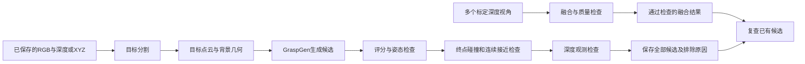

# 3D Vision：多视角桌面抓取规划与避碰

**2026-11-12 纸盒＋水杯多视角点云：** 已将两组各 20 帧的 Gemini 2 实拍深度对齐，生成 123,935 点彩色 PLY 和三维预览；第三组因杯身深度与配准质量不足未合并。见 [实测点云结果](../camera/MULTIVIEW_CUP_BOX.md)。

**纸盒＋水杯仿真场景：** 已仅从融合深度估计盒体与圆柱代理，在 PyBullet 中生成两个可碰撞物体并用两次实拍视角回渲染检查；纸盒/水杯轮廓重合约 88%/78%。接入 UR5 前仍需桌面到机械臂底座标定，详见 [建模与回放结果](../camera/MULTIVIEW_CUP_BOX.md#点云到-pybullet-静态场景)。

**2026-11-12 相机接入：** Windows 已识别 Gemini 2，本机已用官方 SDK 读到对齐的 1920×1080 RGB 与深度帧。镜头调整后已保存真实桌面画面，有效深度约 79.7%；目标分割、畸变处理和桌面标定待完成。双击项目内 `start_gemini2_capture.cmd` 可重新采集，详见 [真机相机记录](../camera/GEMINI2_CAMERA.md)。

**实时画面入口：** 双击 `projects/graspgen_feasibility/start_gemini2_viewer.cmd`，左侧显示彩色图，右侧显示深度图。按 Q 或 Esc 退出。

**真实点云：** 已从 Gemini 2 桌面画面导出约 17.9 万个有效深度点；详见 [真实场景转仿真计划](../camera/REAL_SCENE_SIMULATION.md)。

**冻结桌面布局：** `projects/graspgen_feasibility/start_gemini2_static.cmd` 可采集 20 帧固定机位深度、融合成一次性快照并导出点云；后续场景应保持相机和物体静止，并在连接机械臂前完成底座标定。

**固定桌面单盒重建：** 已在 Gemini 2 拍到单个纸盒并采集 20 帧，融合深度覆盖约 72.5%；拟合桌面和盒子后创建 PyBullet 静态场景。回渲染盒子与手工实拍轮廓重合约 88.5%。尺寸采用尺量值，机器人底座与相机坐标尚未标定。详见 [真实场景重建结果](../camera/REAL_SCENE_SIMULATION.md)。

**2026-11-12 视觉推理进展：** GraspGen 权重和 GPU 扩展已在本机恢复，官方样例及两个虚拟 RGB-D 场景均生成 16 个有效抓取候选。虚拟场景单次模型推理约 0.62 秒；仍需验证夹爪坐标转换后才能连接机械臂执行。双击项目内 `start_graspgen_check.cmd` 可复跑，详见 [推理结果与环境记录](../setup/GRASPGEN_RESTORED.md) 和 [虚拟相机进度](../camera/VIRTUAL_CAMERA.md)。

**最新仿真进展：** UR5＋2F-140 已加入整臂碰撞检查、被抓物体检查与 RRT-Connect 避障；无障碍抓放、绕行、目标被占据拒绝、超出工作空间拒绝四场景通过。启动入口与采样精度限制见 [整臂规划说明](../simulation/MOTION_PLANNING.md)。下文早期路线与阶段记录保留。

**2026-11-11 仿真路线启动：** 当前无实体机械臂，新增独立 PyBullet 单物体抓放基线与 D 盘仿真环境。启动方法、验证边界和后续 2F-140 / Gemini 2 接入步骤见 [仿真说明](../simulation/SIMULATION.md)。下文实机路线和实验结论保留为历史记录；仿真基线使用 Panda，不代表原定夹爪已经适配。

**同日后续：** 已新增 UR5＋社区 2F-140 模型适配，完成 30/50/90 mm 方块物理抓放和夹空验证。该模型含附加指垫，实际开口约 128.5 mm；未完成 GraspGen 坐标对接和整臂避障。详见 [UR5 仿真与验证](../simulation/UR5_SIMULATION.md)。

本文更新于 **2026-10-07**。当前项目面向杂乱桌面分拣：用户选择物体，系统从RGB-D观测中提取目标、生成三维抓取姿态、检查夹爪接近路径，并在遮挡导致观测不足时提示补拍。后续接入机械臂，完成抓取、搬运和放置。

**现阶段已完成离线核心与设备到手前六项准备实验，尚未完成真实相机验收或机械臂执行。** 夹爪固定按 **Robotiq-2F-140** 开发，机械臂型号尚未确定。现有抓取评分、几何检查通过数量均不能当作真实抓取成功率。

## 文档导航

| 想了解什么 | 阅读位置 |
|---|---|
| 完整架构、数据流和模块接口 | [项目README：项目架构](PROJECT_README_legacy.md#architecture) |
| 源码、配置、实验、测试、数据分别放在哪里 | [项目README：文件架构](PROJECT_README_legacy.md#files) |
| 运行入口、输入格式、参数及输出 | [项目README：运行方法](PROJECT_README_legacy.md#run) |
| 拿到相机、机械臂、夹爪后的开发顺序和验收 | [项目README：实机开发方案](PROJECT_README_legacy.md#hardware-plan) |
| 实验结论及尚未解决的问题 | [项目README：当前证据与限制](PROJECT_README_legacy.md#evidence) |
| 下载代码后还缺哪些依赖和资源 | [归档与复现说明](../setup/ARCHIVE.md) |

## 项目架构概览



当前主入口分析单目标、单视角；多视角融合和已有候选复查使用独立入口。融合目标重新生成抓取、真实相机采集、机械臂可达性、整臂轨迹规划和实际执行仍需开发。主算法内部使用米和明确的坐标系，设备接口必须处理单位、工具坐标和时间同步。

## 仓库文件架构

```text
3D_Vision/
├── README.md                         # 仓库入口与项目概览
├── .gitignore                        # 源码、归档产物与本地资源的边界
├── .gitattributes                    # 文本换行；实验归档按原始字节保存
└── projects/
    └── graspgen_feasibility/          # 当前项目
        ├── README.md                 # 详细架构、运行方法与实机开发方案
        ├── offline_core/             # 输入、分割、点云、抓取、避碰、观测、融合
        ├── experiments/              # 合成场景、独立几何参考、输入退化工具
        ├── tests/                    # 单元测试与已保存实验的核验工具
        ├── configs/                  # 默认模型路径和算法参数
        ├── analyze_scene.py          # 单场景分析入口
        ├── fuse_scene.py             # 多视角融合入口
        ├── recheck_fused_scene.py     # 用通过检查的融合结果复查固定候选
        ├── *_experiments.py          # 准备实验入口
        ├── plot_*.py                 # 从已保存结果生成图表
        ├── data/                     # 规范化样例、下载索引；部分原始数据仅本地
        ├── runs/                     # 实验输入、候选、性能、失败样例、图表
        ├── *_RESULTS.md / RESULTS.md  # 分阶段结果报告
        ├── DEVELOPMENT_PLAN.md       # 原始阶段计划与历史进展
        └── ARCHIVE.md                # 上传范围、资源来源及迁移说明
```

本地另有 `.venv/`、`third_party/`、`checkpoints/` 等运行资源，Git不包含这些目录。完整脚本职责和运行产物结构见[详细文件架构](PROJECT_README_legacy.md#files)。

## 当前成果与限制

- 已完成连续接近与碰撞可靠性、遮挡与未观测空间、多视角融合、输入退化鲁棒性、点云规模压力等六项准备实验。
- 后两项共 **207组**：159组鲁棒性、48组压力测试，最大原始点数 **2,517,731**；保留51次预处理中止及6次细障碍采样丢失。
- 最近一次代码验证为 **50项单元测试通过**，结果归档核验通过。实验完成不代表全部实验设置成功。
- 当前仍存在目标选错但候选高分、粗体素与过滤参数不兼容、全量接近检查耗时长等问题；部分合成链路最终候选全部被拒绝，需要真实数据进一步分析。

结果依据：[连续接近与碰撞](COLLISION_EXPERIMENTS.md)、[遮挡与融合](VISIBILITY_FUSION_RESULTS.md)、[鲁棒性与规模压力](ROBUSTNESS_STRESS_RESULTS.md)。

## 设备到手后的开发路线

第一轮实机目标：**固定相机、无遮挡桌面、一个不透明物体、固定放置区、低速执行，完成从拍照到抓放及结果确认的完整流程。**

| 阶段 | 交付内容 |
|---|---|
| 1. 设备接入 | 机械臂状态/运动/停止接口，2F-140开合与反馈，真实几何和工具坐标 |
| 2. 相机与标定 | 可回放RGB-D数据、尺度和对齐检查、相机到机器人坐标标定及独立验证 |
| 3. 指定位置抓放 | 使用人工指定位置验证接近、闭爪、抬起、放下及失败处理 |
| 4. 单视角视觉抓取 | 复用离线核心，新增可达性、整臂规划和执行流程 |
| 5. 障碍与执行复核 | 检查整臂及被抓物体的运动，处理过期观测、目标错误和故障 |
| 6. 多视角补拍 | 获取真实相机位姿、确认同一目标、融合检查及重新生成/复查候选 |
| 7. 实验与展示 | 固定场景对照、真实抓放成功率、失败分类、耗时和可回放界面 |

每阶段的输入、开发工作、验收证据及新增模块见[实机开发方案](PROJECT_README_legacy.md#hardware-plan)。如果只有机械臂先到，先完成阶段1和指定位置抓放；相机先到则先做采集、尺度和离线视觉验证。

## 运行与归档范围

在已恢复模型与依赖的环境中，从项目目录运行归档官方样例：

```powershell
cd projects\graspgen_feasibility
.venv\Scripts\python.exe analyze_scene.py --input data\offline_official\scene.json --no-observation
```

此样例仅含世界XYZ，缺少深度观测所需的相机标定；上述命令用于几何分析，不驱动机械臂。真实标定深度输入默认启用观测检查。环境恢复及其他入口见[项目README](PROJECT_README_legacy.md#run)。

Git保存自编源码、配置、测试、报告，以及当前项目 `runs/` 中除日志外的实验记录和 `data/offline_official/` 的规范化输入。课程资料、下载环境、第三方代码、原始下载数据集、权重和论文不上传。第三方资源遵循各自许可；实验原始字节及历史路径按[归档说明](../setup/ARCHIVE.md)保留。
